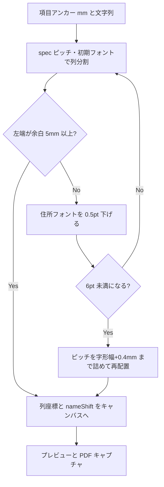

# 宛名住所の枠内折り返し — 設計書

- **Linear Issue**: TOP-41 宛名住所の各項目が長いときに、宛名印刷で枠からはみ出る場合は自動的に改行して位置を調整する
- **ステータス**: Reviewed
- **最終更新**: 2026-10-31

---

## 1. 背景・目的

宛名住所（住所1〜3）は縦書き 1 列で描画している。文字数が多いと下端を超え、プレビューキャンバスの `overflow: hidden` と PDF キャプチャで切れる。

各項目が枠の下端を超えるときは、超えた文字を左隣の列へ折り返し、後続の宛名住所列と宛名氏名が重ならないよう左へずらす。プレビューと PDF は同じキャンバスを使うため、描画を 1 箇所で直す。

## 2. スコープ

### 対象

- 宛名の `recipient.address1` / `address2` / `address3`
- 年賀状・喪中（同一 `layoutSpec`）
- 画面内プレビューと PDF キャプチャ（`PostcardPreviewCanvas`）
- 折り返しに伴う宛名氏名・連名列、および差出人氏名・連名列の水平位置調整
- 差出人の `sender.address1` / `address2` / `address3`

### 非スコープ

- 宛名氏名・差出人氏名そのものの縦方向の折り返し（長い氏名は従来どおり）
- 郵便番号枠
- レイアウトオフセットの永続化仕様の変更（折り返し量は保存しない）
- 住所データの分割ルール変更（DB・スナップショットの文字列はそのまま）
- フォントの手動指定 UI

## 3. 要件

### 機能要件

| ID | 内容 |
|----|------|
| FR-01 | 宛名住所の各項目は、縦書きの下端が枠を超えるとき、超えた文字を同じ項目の左隣列へ折り返す。年賀状の枠下端は下部の年賀表記（赤線、上端から約 129mm）の直前 **128mm**。喪中ははがき高さ − 余白 5mm（143mm） |
| FR-02 | 折り返し列の先頭 Y は、その項目の 1 列目と同じ（縦書きの改行。下端からの継続ではない） |
| FR-03 | 文字順は右列を上から下へ読み、次に左列を上から下へ読む |
| FR-04 | 右にある項目の折り返しで増えた列数だけ、左にある宛名住所項目を列ピッチ分左へずらす |
| FR-05 | 宛名氏名列と宛名連名列も、増えた列数の合計 × 列ピッチだけ左へずらす。列内の姓・名・敬称の相対位置は変えない |
| FR-06 | どの宛名住所項目も 1 列に収まるときは、現行の座標から動かない。右の項目が折り返したときは、左の短い項目も FR-04 に従ってずれる |
| FR-07 | 調整は印刷項目（1 枚）ごとの文字列と、その時点のレイヤー原点（ユーザーオフセット適用後）から計算する。`print_layout_preferences` には書かない |
| FR-08 | 住所列の左端が左余白 5mm を割るときは、その住所のフォントを 6pt まで 0.5pt 刻みで下げて再計算する。6pt でも割るときは列ピッチを字形幅 + 0.4mm まで詰める。氏名・連名だけが余白を割るときはフォントを下げず、満サイズの折り返しを残す（氏名は余白側にはみ出し得る） |
| FR-09 | 空文字・非表示の項目は列を作らず、折り返し列数にも数えない |
| FR-10 | 差出人住所も FR-02〜FR-09 と同じ規則で折り返す。下端は年賀・喪中の宛名下端と、差出人郵便番号枠の上端 − 1mm の、より上の方。増えた列数だけ差出人氏名・連名を左へずらす |

### 非機能要件

- オフラインのまま完結する（フロントのレイアウト計算のみ）
- プレビューと PDF で同じ配置になる
- 既存のドラッグは項目単位のまま（折り返し列は親レイヤーに追従）
- 文字サイズの下限は印刷方針の 6pt

## 4. 現状分析

### 関連 docs

- [postcard-address-print-v1-design.md](./postcard-address-print-v1-design.md) — 宛名面印刷。v1 はレイヤー原点のクランプのみで、縦書きの bbox は見ていない
- [printing-layout-decision.md](../tech-decisions/printing-layout-decision.md) — 100×148mm、余白 5mm、6pt 以上、縦書き、フロント描画
- [requirements-and-constraints.md](../overview/requirements-and-constraints.md) — オフライン、Tauri + React + SQLite

v1 設計書の印字ルール表は住所 2 分割の初期案である。実装は 3 分割なので、本設計は実装に合わせる。

### 関連実装

| 箇所 | 現状 |
|------|------|
| `print_snapshot.rs` `address_lines` | 住所1 = 都道府県+市区町村、住所2 = 町名番地、住所3 = 建物 |
| `nengaLayoutSpec.ts` | 住所1 `(87.5, 26)`、住所2 `(79.5, 36)`、住所3 `(71.5, 46)`。基準フォント 11pt。氏名 X は 60.5、連名 X は 48.5 |
| `printTypography.ts` | 描画フォントは `11 * LAYOUT_FONT_SCALE (1.5) = 16.5pt`。1 文字の送りは `toMm(fontSizePt)`（CSS の `1em` と一致） |
| `PostcardPreviewCanvas.tsx` | 住所は `VerticalText` の 1 列。氏名だけ `computeColumnPositions` で縦に積む。キャンバスは `overflow: hidden` |
| PDF | `renderPrintPdf.tsx` が同じキャンバスをキャプチャする |

列ピッチは `address1.x - address2.x` = 8mm。16.5pt の字形幅は約 5.82mm なので、列間は約 2.2mm 空く。

住所1の Y=26、年賀状の下端=128 のとき 1 列に入る文字数は `floor(102 / toMm(16.5))` = 17 字。これを超える町名番地・建物名は、下部の年賀表記に届く前に左の列へ折り返す。

### ギャップ

- 折り返しがない
- 後続列・氏名を空ける処理がない
- はみ出し量は保存すべきユーザー調整ではない

## 5. 設計

### 5.1 データモデル / DB

変更なし。スナップショットの `addressLine1..3` は 1 文字列のまま。折り返しは描画時だけ。

### 5.2 API / Tauri コマンド

変更なし。

### 5.3 フロントエンド

純関数 `layoutRecipientAddressColumns` を `src/features/print/layout/addressColumnWrap.ts` に置く。キャンバスは結果の列座標とフォントだけを使う。

#### 入力

- 対象 3 項目。各項目は id、文字列、表示可否、オフセット適用後のアンカー mm
- `specPitchMm` = `recipient.address1.origin.x - recipient.address2.origin.x`（0 以下なら字形幅 + 0.4mm）
- `bottomYMm` = `layoutSpec.recipientAddressBottomMm`（年賀状 128、喪中 143）
- `leftLimitMm` = `marginMm`（5）
- `nameLeftMm` = 表示中の宛名氏名・連名列アンカー X の最小。該当が無ければ `null`
- `initialFontSizePt` = `scaledFontSizePt(address1 の基準 pt)`

#### 1 列に入る文字数

```
advance = toMm(fontSizePt)
available = bottomYMm - anchorY
maxChars = available > 0 かつ advance > 0 なら max(1, floor(available / advance)) else 1
```

コードポイント単位（`[...text]`）。ハイフン回転は既存 `VerticalText` のまま各列に適用する。

#### 通常配置（列ピッチ = specPitch）

表示中かつ非空の項目だけを、住所1 → 住所2 → 住所3 の順に処理する。

```
extraBefore = 0
fieldX = anchorX - extraBefore * pitch
列 i の位置 = (fieldX - i * pitch, anchorY)
extraBefore += 列数 - 1
nameShiftLeftMm = extraBefore * pitch
```

空・非表示は `extraBefore` を増やさない。項目ごとの X オフセットはアンカーに含まれたまま残る。

#### 枠の判定

折り返しで左へ動かした端だけを見る。アンカーそのものが余白の外にある状態（ドラッグ結果）ではフォントを下げない。

次が `leftLimitMm` 以上なら収まる。

- 1 列目以外の住所列 X、および前の項目の追加列で左へずれた項目の X
- `nameLeftMm - nameShiftLeftMm`（追加列があり、`nameLeftMm` があるとき）

#### 収まらないとき

1. フォントを 0.5pt ずつ下げ、6pt になるか収まるまで、ピッチは spec のまま再計算する
2. 6pt でも収まらなければ、ピッチだけを `glyph + 0.4mm` 以上かつ spec 以下の範囲で、左端が `leftLimitMm` 以上になる最大値にする。解析的に求める（列数はフォントだけで決まる）
3. その下限ピッチでも左端が余白を割るときは、下限ピッチのまま置く

氏名・連名のフォントは変えない。縮むのは宛名住所 3 項目の共通サイズだけ。

#### キャンバス

- 対象レイヤーは 1 つのドラッグ要素のまま。子に列を絶対配置し、要素の幅は全列を覆う
- `left` / `top` は列群の左端と列の Y
- 氏名・連名の列原点 X から `nameShiftLeftMm` を引いてから、既存の `computeColumnPositions` を行う
- 差出人住所も同じ関数で複数列にする。下端は `min(宛名の下端, 郵便番号枠の上端 − 1mm)`。差出人氏名・連名の X から `nameShiftLeftMm` を引く

### 5.4 フロー



## 6. エッジケース・エラー処理

| 状況 | 扱い |
|------|------|
| ちょうど `maxChars` 字 | 1 列。シフト 0 |
| 1 字超過 | 2 列目は左へ 1 ピッチ。後続と氏名を 1 ピッチ左へ |
| 住所3だけ長い | 住所1・2は動かない。氏名は住所3の追加列数だけ左へ |
| 住所2が空 | 列を作らない。住所3のアンカー X は維持（空列の詰めなし） |
| アンカー Y が下端以上 | 1 字ずつ折り返す。縦にはみ出し得る |
| ユーザーが下へドラッグ | その項目の `maxChars` が減り、折り返しが増える |
| 氏名を非表示 | 住所列の左端だけで余白を判定する |
| 連名あり | 連名列の X が氏名より左なら、そちらを `nameLeftMm` にする。シフト量は氏名列と同じ |
| 6pt・最小ピッチでも不足 | 重ねず、左余白を割り得る。文字は捨てない |
| 差出人住所が郵便番号枠に届く | 枠の 1mm 上で折り返す。郵便番号の桁位置は変えない |

## 7. テスト方針

`addressColumnWrap.test.ts`（Vitest）で純関数を固定する。

- 短い文字列は 1 列、シフト 0、アンカー座標のまま
- 下端を超える文字列は右から左へ分割され、文字が欠けない
- 住所1の追加列だけ住所2と氏名シフトが増える
- 空項目は無視する
- フォント低下で収まるケースと、6pt でピッチを詰めるケース
- `maxChars` ちょうどの境界

キャンバスは純関数の結果を描くだけにし、DOM では長い住所1が複数列になることと、短いときは氏名 X が仕様原点のままであることを 1 本見る。

Rust / migration / コマンドのテストは追加しない。

## 8. 実装タスク（参考）

1. `addressColumnWrap.ts` とユニットテスト
2. `PostcardPreviewCanvas` で宛名住所の複数列描画と氏名・連名の X シフト
3. キャンバスの回帰（短い住所で座標が変わらないこと）
4. `npm test` を変更範囲で実行し、スキルの検証一式を実行する

## 9. 未決事項

- 宛名氏名・差出人氏名が長いときの縦方向のはみ出しは v1 のまま（手動の位置調整）
- v1 設計書の「住所 2 分割」表は初期案。実装の 3 分割は本設計の前提であり、v1 本文の表は歴史として残す
