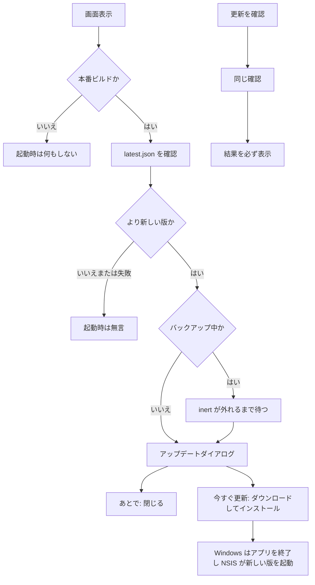

# アプリケーション内アップデート — 設計書

- **Linear Issue**: [TOP-37](https://linear.app/topea-3/issue/TOP-37/アプリケーションのアップデート機構を追加する) アプリケーションのアップデート機構を追加する
- **ステータス**: Reviewed
- **最終更新**: 2026-11-01

---

## 1. 背景・目的

配布は GitHub Releases の Windows NSIS（`.exe`）である。現行ビルドには更新確認がなく、利用者は新しい `.exe` を自分で入れ替える。

公開リポジトリ `topea-3/craft-post-app` に、署名付きの更新情報 `latest.json` を載せ、インストール済みアプリから新しい版を検知して入れられるようにする。日常の住所録・印刷はオフラインのままにする。通信は更新確認と更新パッケージの取得だけとする。

この機構を含むビルドより前のインストールは、アプリ内からは更新できない。その次のリリースを一度手動で入れたあとから、アプリ内更新が使える。

---

## 2. スコープ

### 対象

| 領域 | 内容 |
|------|------|
| アプリ | `tauri-plugin-updater` と `tauri-plugin-process`。起動時の静かな確認と、サイドバーからの手動確認 |
| 署名 | 公開鍵は `tauri.conf.json`。秘密鍵は GitHub Actions secret のみ |
| Release CI | 既存の NSIS `.exe` に加え、`.exe.sig` と `latest.json` を同じ Release へ載せる |
| 方針 docs | 「Updater は後から」を本設計への参照へ更新する（本設計と同時に反映済み） |

### 非スコープ

- macOS / Linux の更新成果物（初版の配布は Windows のまま）
- Windows ARM64 用ビルド
- OS のコード署名（Authenticode）と SmartScreen 対策
- ダウングレード、リリースチャネル、ベータ配信
- 独自の更新サーバ、認証付き URL、プライベートリポジトリ向け配信
- 「この版をスキップ」の永続化
- 更新に伴う DB の特別扱い（スキーマは従来どおり起動時の sqlx マイグレーション）
- ライセンス確認など、更新以外のオンライン通信

### ユーザー確認（2026-11-01）

| 論点 | 決定 |
|------|------|
| 作業ブランチ | `develop` から `feature/TOP-37_app-update-mechanism` |
| 範囲 | アプリ（プラグイン、設定、更新 UI）と Release CI（署名付き成果物と `latest.json`） |
| 確認のきっかけ | 起動時は更新があるときだけダイアログ。手動確認は結果を必ず表示する |
| 配信 | 公開 GitHub Releases の静的 `latest.json`（リポジトリは public） |

---

## 3. 要件

### 機能要件

| ID | 要件 |
|----|------|
| FR-01 | 起動して画面を出したあと、プロセスにつき 1 回だけ更新を確認する。確認の完了を待たずに操作できる |
| FR-02 | 起動時の確認で、より新しい版があるときだけダイアログを出す。同じ版、より新しい版がない、通信失敗、タイムアウトでは何も出さない |
| FR-03 | サイドバーに「更新を確認」を置く。ページ遷移にはしない。結果は必ず表示する（最新 / 更新あり / 確認できない / 開発中は確認しない） |
| FR-04 | `import.meta.env.PROD` が偽のときはプラグインの `check` を呼ばない。起動時は無言。手動では「開発中は更新を確認できません」と出す |
| FR-05 | 更新ダイアログは、現在の版、新しい版、リリースノートをプレーンテキストで見せる。操作は「今すぐ更新」と「あとで」 |
| FR-06 | 「あとで」はダイアログを閉じるだけとする。スキップした版は保存しない。次の起動で、まだ古ければ再度出す |
| FR-07 | 「今すぐ更新」はダウンロードしてインストールする。バイト数が分かるときは進捗、分からないときは「ダウンロードしています」と出す。開始後は取り消さない |
| FR-08 | インストールの前に、Windows ではインストールのためアプリが終了することをダイアログに書く |
| FR-09 | 確認は同時に 1 つ。タイムアウトは 30 秒。手動確認が起動時の確認と重なったときは、同じ結果を使う |
| FR-10 | エンドポイントは `https://github.com/topea-3/craft-post-app/releases/latest/download/latest.json` のみ。HTTP は使わない |
| FR-11 | 署名検証はプラグインに任せる。検証に失敗したパッケージはインストールしない |
| FR-12 | バックアップまたはリストアが `.app-layout` を `inert` にしているあいだは、更新ダイアログを出さない。インストールも始めない。`inert` が外れてから、保留していた起動時ダイアログを出す |
| FR-13 | Release CI は従来の NSIS `.exe` を残す。加えて同じ版の `.exe.sig` と `latest.json` をその Release に載せる |
| FR-14 | `latest.json` の対象は `windows-x86_64` だけ。URL はその Release の `.exe`。署名は `.sig` の中身 |
| FR-15 | 秘密鍵とパスフレーズはリポジトリ、ログ、設計書に書かない。公開鍵文字列だけを `plugins.updater.pubkey` に置く |

### 非機能要件

- 住所録・印刷・バックアップの通常操作はオフラインのまま動く。更新確認の失敗でそれらを止めない
- 画面に出す失敗文言は固定の日本語。プラグインの英語メッセージはそのまま出さない。詳細は開発者ツールへ残してよい
- リリースノートは HTML として解釈しない
- WebView の CSP は変えない。更新の通信は Rust 側のプラグインが行う
- より古い版への入れ替えはしない（プラグインの既定比較）
- DB マイグレーションとドメインコマンドは追加しない

---

## 4. 現状分析

### 関連 docs

| 文書 | 関係 |
|------|------|
| [requirements-and-constraints.md](../overview/requirements-and-constraints.md) | 日常利用はオフライン。オンラインは更新取得などに限る |
| [release-workflow.md](../project-setup/release-workflow.md) | develop → main のマージで Windows NSIS を GitHub Releases へ載せる |
| [tauri-updater-feasibility.md](../project-setup/tauri-updater-feasibility.md) | TOP-33。公開 GitHub と `tauri-plugin-updater` で実現できる、という調査 |
| [repository-and-branch-strategy.md](../project-setup/repository-and-branch-strategy.md) | 4.4 は本設計を参照する。手動の `.exe` 配布は残す |

### 関連実装

| 箇所 | 現状 |
|------|------|
| `src-tauri/tauri.conf.json` | `version` は `0.1.1`。`bundle.targets` は `"all"`。updater 設定は無い |
| `src-tauri/tauri.dev.conf.json` | 開発時は `com.topea.craftpost.dev` / `Craft Post Dev`。本体設定にマージされる |
| `src-tauri/src/lib.rs` | `tauri_plugin_dialog` のみ。updater は未登録 |
| `src-tauri/capabilities/default.json` | `core:default` と `dialog:default`。対象ウィンドウは `main` |
| `src-tauri/Cargo.toml` | `tauri ~2.10.3`。`rust-version` は `1.88` |
| `.github/workflows/release.yml` | `npm run tauri build -- --bundles nsis`。`.exe` だけを Release へ載せる。署名 secret は無い |
| `src/App.tsx` | サイドバーは経路への `NavLink` のみ |
| ダイアログ | `.dialog-overlay` / `.dialog-panel`（差出人選択など）。バックアップ中は `.app-layout` に `inert` |

公式の Updater（参照日 2026-11-01）では、Windows かつ `createUpdaterArtifacts: true` のとき、更新パッケージは NSIS の `.exe` 本体で、隣に `.exe.sig` ができる。`v1Compatible` は使わない。このアプリに Tauri v1 の更新利用者はいない。

プラグインのドキュメントは Rust 1.90 以上を要求する。ローカルの stable は 1.94.0。CI は `stable`。

Windows ではインストール段階でアプリが終了する。`relaunch()` まで戻らない。再起動は NSIS の更新インストールに任せる。`installMode` は既定の `passive`（小さな進捗窓。追加のクリックは不要）。

### ギャップ

- プラグイン、権限、公開鍵、エンドポイントが無い
- 起動時確認と手動確認の UI が無い
- Release に署名と `latest.json` が無い
- `rust-version = "1.88"` はプラグイン要件より古い

---

## 5. 設計

### 5.1 データモデル / DB

変更しない。更新後のスキーマ適用は、今どおり起動時の sqlx マイグレーションに任せる。

### 5.2 プラグインと設定

フロントから公式プラグインを呼ぶ。差出人選択がファイルダイアログをフロントから呼ぶのと同じ扱いにする。更新対象はドメインデータではないため、新しい Tauri コマンドとドメイン層は作らない。

登録は `lib.rs` の `tauri_plugin_dialog` の隣とする。

- `tauri_plugin_updater::Builder::new().build()`
- `tauri_plugin_process::init()`

依存は Tauri 2 系のまま、updater は CVE-2026-95625 の修正が入った版にする。`tauri` と `@tauri-apps/cli` は `~2.12.4`、`tauri-plugin-updater` と `@tauri-apps/plugin-updater` は `~2.14.1`。`rust-version` は 1.90。Tauri 本体のメジャーは上げない。

`capabilities/default.json` に次を足す。

- `updater:default`（`check` / `download` / `install` / `download-and-install`）
- `process:allow-restart`

`tauri.conf.json`:

```json
{
  "bundle": {
    "createUpdaterArtifacts": true
  },
  "plugins": {
    "updater": {
      "pubkey": "<tauri signer generate が出力する公開鍵文字列>",
      "requireSignedVersion": true,
      "endpoints": [
        "https://github.com/topea-3/craft-post-app/releases/latest/download/latest.json"
      ],
      "windows": {
        "installMode": "passive"
      }
    }
  }
}
```

`pubkey` はファイルパスにしない。`dangerousInsecureTransportProtocol` は置かない。`requireSignedVersion` は最初の updater 対応版から true にする。署名の trusted comment に版が無い成果物は拒否する。CLI は 2.12 以上でないと、その comment を付けられない。

`bundle.targets` と CI の `--bundles nsis` は維持する。MSI は Release に載せない。

`rust-version` は、採用する `tauri-plugin-updater` の MSRV 以上にする。ドキュメント上の下限は 1.90。1.88 のままにしない。

#### 鍵

実装者が次を行い、秘密鍵はコミットしない。

1. `npm run tauri signer generate -- -w` で、リポジトリの外にパスフレーズ付きの鍵を作る
2. 秘密鍵の中身を GitHub Actions secret `TAURI_SIGNING_PRIVATE_KEY` に入れる
3. パスフレーズを `TAURI_SIGNING_PRIVATE_KEY_PASSWORD` に入れる
4. 公開鍵文字列だけを `plugins.updater.pubkey` に書く
5. 秘密鍵の控えをリポジトリと CI ログの外に残す。失うと、その公開鍵で入ったアプリへ次の更新を出せなくなる

どちらかの secret が空のとき、Release ジョブは署名なしで成功させない。

開発用の `tauri.dev.conf.json` にはエンドポイントを足さない。開発ビルドでは確認自体を呼ばない。

### 5.3 フロントエンド

配置は `src/features/update/`。画面ルートは増やさない。

| モジュール | 役割 |
|------------|------|
| `updateCheck.ts` | `check` の単一フライト、30 秒タイムアウト、結果の分類 |
| `UpdateChecker.tsx` | 起動時 1 回、ダイアログ、サイドバーのボタンと結果 |
| `updateCheck.test.tsx` | プラグインをモックした振る舞い |

`AppLayout` のナビの下に「更新を確認」ボタンを置く。`NavLink` にはしない。結果文はボタンの直下に `aria-live="polite"` で出す。

ダイアログは既存の `.dialog-overlay` / `.dialog-panel` を使う。`role="dialog"`、`aria-modal="true"`、タイトルは「アップデート」。`document.body` へ出す。バックアップが `.app-layout` に付けた `inert` のあいだは開かず、外れてから開く。

起動時は `useEffect` で 1 回だけ `checkForUpdate()` を呼ぶ。本番以外は即 return する。

手動確認も同じ関数を使う。進行中なら新しい `check` は投げず、進行中の Promise を待つ。

`check` は `@tauri-apps/plugin-updater` の `check({ timeout: 30_000 })`。追加ヘッダとプロキシは無い。

| 結果 | 起動時 | 手動 |
|------|--------|------|
| より新しい版がある | ダイアログ | ダイアログ。ボタン下にも「新しいバージョンがあります」 |
| 更新なし（`null`） | 無言 | 「お使いのバージョンは最新です。（現在の版）」 |
| 例外またはタイムアウト | 無言 | 「更新を確認できませんでした。」 |
| 本番以外 | 無言 | 「開発中は更新を確認できません。」 |

現在の版は `@tauri-apps/api/app` の `getVersion()`。取れなければ版の括弧を省く。

ダイアログの本文:

- 「バージョン {新版} が利用できます。（現在 {現版}）」
- ノートが空でなければ、その文字列をテキストノードで表示する（`white-space: pre-wrap`、はみ出しはスクロール）
- 「インストールを始めると、アプリはいったん終了します。」

「今すぐ更新」で `downloadAndInstall` を呼ぶ。進捗イベントは次のとおり。

| イベント | 表示 |
|----------|------|
| `Started` かつ `contentLength` あり | 受信バイト / 全体 |
| `Progress` | 受信バイトを足す |
| `contentLength` なし | 「ダウンロードしています」 |
| 失敗 | 「アップデートをインストールできませんでした。あとでもう一度試せます。」ダイアログは開いたまま。「今すぐ更新」を再度押せる |
| 成功 | 続けて `relaunch()` を呼ぶ。Windows ではここへ戻らずプロセスが終了する前提とする |

ダウンロード中は両方のボタンを無効にする。

### 5.4 リリース成果物

`tauri-action` へは切り替えない。`.github/workflows/release.yml` の NSIS ビルドを拡張する。

ビルドステップの環境変数:

- `TAURI_SIGNING_PRIVATE_KEY`
- `TAURI_SIGNING_PRIVATE_KEY_PASSWORD`

ビルド後、`src-tauri/target/release/bundle/nsis` から `.exe` を 1 つと、同じパスに `.sig` を付けたファイルを見つける。どちらかが無い、または `.exe` が複数ならジョブを失敗させる。

マニフェストは `scripts/write-updater-manifest.mjs` が書く。ワークフローは引数で渡し、JSON を手で連結しない。

入力は `version`（`X.Y.Z`）、ノート文字列、`.sig` のパス、`.exe` のファイル名、タグ `vX.Y.Z`、`topea-3/craft-post-app`、RFC 3339 の `pub_date`。

出力 `latest.json`:

```json
{
  "version": "0.2.0",
  "notes": "リリースノート",
  "pub_date": "2026-11-01T00:00:00Z",
  "platforms": {
    "windows-x86_64": {
      "signature": "<.sig の中身を trim>",
      "url": "https://github.com/topea-3/craft-post-app/releases/download/v0.2.0/Craft%20Post_0.2.0_x64-setup.exe"
    }
  }
}
```

- `version` は三つのマニフェストと同じ `X.Y.Z`。先頭の `v` は付けない
- `url` のファイル名だけ `encodeURIComponent` する。空白は `%20`
- `signature` が空、版が SemVer でない、ファイル名が空、ならスクリプトは非 0 で終わる
- プラットフォームキーは `windows-x86_64` だけ。空の darwin / linux は置かない（プラグインはファイル全体を検証する）

アップロードは既存の `softprops/action-gh-release` の `files` に、`.exe`、`.exe.sig`、`latest.json` を渡す。`fail_on_unmatched_files` は維持する。タグが同じ SHA で既にある再実行でも、三つのファイルを置き直す。

ノートは、いま Release 本文に使っている PR の「変更内容のサマリ」と同じ文字列にする。

### 5.5 フロー



手動の `.exe` 配布は残る。アプリ内更新を一度も入れていない利用者は、この機構が入った Release を GitHub Releases から入れてから、次の版をアプリ内で受け取る。

---

## 6. エッジケース・エラー処理

| 状況 | 振る舞い |
|------|----------|
| まだ `latest.json` がどの Release にも無い | 起動時は無言。手動は「更新を確認できませんでした。」 |
| オフライン、タイムアウト、非 2xx | 同上 |
| 署名不一致、JSON 不正 | インストールしない。手動は確認失敗の文言。起動時は無言 |
| 実行中の版が `latest.json` 以上 | 更新なし |
| ARM64 で `windows-x86_64` が一致しない | 更新を出さない。手動は確認失敗になりうる。ARM 用成果物は作らない |
| ダウンロード中の失敗 | ダイアログにインストール失敗の文言。アプリは閉じない |
| バックアップ / リストアの `inert` 中 | ダイアログもインストールも始めない。サイドバーは既存の `inert` で押せない |
| 開発ビルド（`tauri dev`） | `check` しない。製品版の上書きインストールを避ける |
| 秘密鍵を失った | 同じ公開鍵のインストールへは次の更新を出せない。新しい鍵は、その鍵が入った版を手動インストールした利用者にしか効かない |
| 再実行で同じタグ | SHA が HEAD と一致するときだけ、成果物と `latest.json` を置き直す（現行 CI のタグ方針のまま） |

---

## 7. テスト方針

### フロント（Vitest）

`@tauri-apps/plugin-updater`、`@tauri-apps/plugin-process`、`getVersion` をモックする。

- 本番かつ更新あり: 起動時にダイアログが出る
- 本番かつ `null`: ダイアログは出ない
- 本番かつ `check` が拒否: ダイアログは出ない
- 手動かつ `null`: 「お使いのバージョンは最新です。」
- 手動かつ更新あり: ダイアログ
- 手動かつ失敗: 「更新を確認できませんでした。」
- 本番以外の手動: 「開発中は更新を確認できません。」かつ `check` は呼ばれない
- 「あとで」でダイアログが閉じ、`downloadAndInstall` は呼ばれない
- 「今すぐ更新」で `downloadAndInstall` のあと `relaunch` が呼ばれる
- 進行中の確認に手動が重なっても `check` は 1 回
- `.app-layout` が `inert` のあいだはダイアログを出さず、外したあとに出す
- ノートに HTML 文字列を渡しても、要素として解釈されない

### マニフェスト（`node --test`）

`scripts/write-updater-manifest.test.mjs`

- 空白を含むファイル名が `%20` になる
- `signature` の前後空白を除いた中身が入る
- プラットフォームは `windows-x86_64` だけ
- 空の署名、空のファイル名、SemVer でない版は失敗する

Release YAML 自体の結合テストは作らない。署名鍵が必要な `tauri build` も CI の通常ジョブには足さない。

---

## 8. 実装タスク（参考）

1. メンテナが鍵をリポジトリの外で生成し、二つの secret を GitHub に登録する。公開鍵だけを設定へ書く
2. updater と process の依存、`lib.rs`、capability、`tauri.conf.json`、`rust-version` を更新する
3. `src/features/update/` の確認ロジックとダイアログ、サイドバーのボタンを入れる
4. `scripts/write-updater-manifest.mjs` とテストを追加し、`release.yml` から呼ぶ
5. フロントの Vitest と `node --test scripts/write-updater-manifest.test.mjs` を通す

実装完了の条件に、公開鍵が `tauri.conf.json` にあり、秘密鍵が git の追跡対象に無いことを含める。鍵が渡される前に空の `pubkey` でリリースジョブを成功させない。

---

## 9. 未決事項

なし。

---

## 変更履歴

| 日付 | 内容 |
|------|------|
| 2026-11-01 | TOP-37。初版。起動時と手動の確認、公開 GitHub の `latest.json`、NSIS 署名成果物を設計。 |
| 2026-11-01 | CVE-2026-95625 対応。updater 2.14、Tauri / CLI 2.12、`requireSignedVersion`、Rust 1.90。 |
