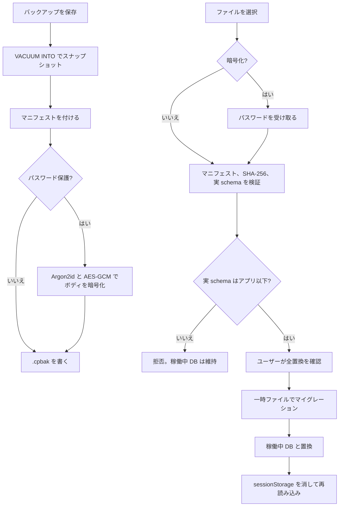

# バックアップ・リストア — 設計書

- **Linear Issue**: [TOP-40](https://linear.app/topea-3/issue/TOP-40/バックアップリストア機能の設計) バックアップ・リストア機能の設計
- **ステータス**: Reviewed
- **最終更新**: 2026-10-17

---

## 1. 背景・目的

住所録・差出人・送受信履歴・印刷レイアウトは、端末ローカルの SQLite（`craft_post.db`）にだけある。アンインストールやユーザーデータの削除で消える。クラウドには置かない。

ユーザーが任意のタイミングで、その DB 全体を 1 ファイルとして保存し、あとから現在の DB と置き換えて戻せるようにする。

---

## 2. スコープ

### 対象

| 領域 | 内容 |
|------|------|
| バックアップ | 起動中の DB から一貫したスナップショットを作り、マニフェストと一緒に `.cpbak` へ書く |
| リストア | `.cpbak` を検証し、現在の `craft_post.db` を全置換する。古いスキーマは置換前に前方マイグレーションする |
| パスワード | 作るときに任意。保護したファイルは復元時にパスワードが要る |
| 画面 | サイドメニュー「バックアップ」（`/settings/backup`） |
| DB 接続 | リストアでファイルを差し替えるため、プールを差し替えられる `AppDb` を導入する |

### 非スコープ

- オンライン / クラウドバックアップ
- ローカル自動バックアップ（頻度・保存先・保持数）。要件には残し、別 Issue で設計する
- 論理 JSON / CSV の入出力（住所録ドメインで別検討のまま）
- 一部テーブルだけ、または既存行へのマージ
- バックアップファイルの中身を人が編集する機能
- 前回の保存先をアプリが覚えること
- API デバッグログ、生成した PDF、アプリ本体、フォント

### ユーザー確認（2026-10-17）

| 論点 | 決定 |
|------|------|
| 作業ブランチ | `develop` から `feature/TOP-40_backup-restore-design` |
| 方式 | SQLite の一貫コピー + マニフェスト JSON（`.cpbak`） |
| 自動バックアップ | 今回の設計に含めない |
| リストア | 現在の DB を全置換する |
| 保護 | 暗号化しないことも、パスワードで保護することもできる |

---

## 3. 要件

### 機能要件

| ID | 要件 |
|----|------|
| FR-01 | バックアップは `craft_post.db` の全内容（全テーブルと `_sqlx_migrations`）を含む。テーブル一覧をアプリ側で列挙しない |
| FR-02 | スナップショットは `VACUUM INTO` で作る。開いている接続からのファイルコピーはしない |
| FR-03 | 成果物は 1 ファイル。拡張子は `.cpbak`。既定のファイル名は `craft-post-backup-YYYYMMDD-HHMMSS.cpbak`（端末ローカル時刻） |
| FR-04 | パスワード保護はチェック式。オフのときは平文コンテナ。オンのときはパスワード必須 |
| FR-05 | パスワードは先に NFC 正規化し、そのあとの Unicode スカラー数が 8 以上 128 以下。空文字では保護しない。作成画面の確認も、比較の前に両方を NFC 正規化する |
| FR-06 | 保護時の暗号は Argon2id（version `0x13`）+ AES-256-GCM。v1 が読む KDF パラメータは書き込み値（19456 KiB / 2 / 1）だけ。タグは暗号文の末尾 16 バイト |
| FR-07 | 保存先はユーザーが保存ダイアログで選ぶ。未作成パスは親ディレクトリを canonicalize してファイル名を結合してから、稼働中 DB と復元用一時ファイルを拒否する |
| FR-08 | リストアはファイル選択後に、作成日時、アプリのバージョン、スキーマ、サイズ、パスワード保護の有無を見せ、確認チェックのあとでだけ実行する |
| FR-09 | リストアは現在の DB をバックアップの内容で置き換える。マージしない |
| FR-10 | マニフェストではなく、バックアップ内 `_sqlx_migrations` の実 version がアプリの最新より新しいときは置き換えない。マニフェストと実 version が違えば拒否する |
| FR-11 | 実 version がアプリと同じか古いときは、稼働中 DB を触る前に検証済みの一時ファイルへ前方マイグレーションし、成功したときだけ置き換える。同じ version では追加の適用は無い |
| FR-12 | 置き換えに失敗したとき、または起動時に中断跡があるときは、置換前の DB に戻す |
| FR-13 | 復元成功後、`reload` の前に `sessionStorage.clear()` する。現行の `printJobDraft` と `printPostcardType` を含む。消したあと `craftPostRestoreNotice=ok` だけ書き戻して再読み込みし、復元した旨を一度だけ出す |
| FR-14 | パスワードとファイル本文はログに出さない |

### 非機能要件

- オフライン完結。ネットワークは使わない
- バックアップとリストアは同時に 1 つ。write lock は 30 秒まで待ち、取れなければ `busy`
- その他の DB コマンドは、共通の `AppDb::with_read` で read lock を 3 秒まで待つ。バックアップまたはリストアが write lock を持っているときは、操作の完了まで待たず平文で同じ文言を返す
- バックアップ、リストア、内容確認のあいだは、サイドメニューを含む画面全体を操作不能にする
- `VACUUM INTO`、Argon2id、AES-256-GCM、SHA-256 は `spawn_blocking` で実行し、tokio のランタイムを占有しない。バックアップとリストアは write lock を保持したまま
- コンテナの上限は 512 MiB。作成側も読み取り側も超えたファイルは残さない。マニフェスト JSON の上限は 64 KiB
- 復号とハッシュは一時ファイルへストリームする。verify に書くのは DB バイトだけで、マニフェストはメモリ上の JSON に留める。平文ボディと暗号文を同時にメモリへ全量載せない。GCM のタグが一致するまで、その一時ファイルを SQLite として開かない
- 個人情報は端末の外へ送らない。保護しないファイルは、保存先の OS 権限だけに依存する
- 開発用 identifier（`com.topea.craftpost.dev`）と本番（`com.topea.craftpost`）の DB は別ファイルである。`.cpbak` はスキーマが互換ならどちらへも復元できる

---

## 4. 現状分析

### 関連 docs

| ドキュメント | 関係 |
|-------------|------|
| [requirements-and-constraints.md](../overview/requirements-and-constraints.md) | 手動バックアップ、ローカル自動、リストア、クラウドなし。本設計で手動方式を確定し、自動は別 Issue と明記する |
| [data-persistence-decision.md](../tech-decisions/data-persistence-decision.md) | SQLite 1 ファイル。JSON/CSV も候補だった。TOP-40 で手動は `.cpbak` に決定 |
| [architecture-overview.md](../overview/architecture-overview.md) | 設定・バックアップ画面はラフのみ。自動は将来のまま |
| [decisions-summary.md](../overview/decisions-summary.md) | バックアップ行が JSON/CSV 前提。本設計への参照に更新する |
| 各 v1 設計の非スコープ | CSV 入出力とバックアップは後続のまま。CSV は本設計でも対象外 |
| [address-domain-v1.md](../domain/address-domain-v1.md) | CSV 仕様は別タイミング。DB スキーマは変えない |

### 関連実装

| 領域 | 現状 | ギャップ |
|------|------|----------|
| DB | `BaseDirectory::AppData` の `craft_post.db`。`sqlx` プールを `app.manage(pool)` で固定。ジャーナルは既定の DELETE。WAL は有効にしていない | プールを後から差し替えられない。`VACUUM INTO` と復元のリネーム手順が無い |
| 永続データ | `address_entries` / `address_co_recipients`、`sender_entries` / `sender_co_recipients` / `sender_address_links`、`postcard_receipts`、`postcard_sends` / `print_layout_preferences`、`_sqlx_migrations` | すべて DB ファイルに含まれる。ファイル単位で足りる |
| ログ | API デバッグログはセッション内だけ。DB に無い | バックアップ対象外 |
| コマンド | `State<'_, SqlitePool>` を各コマンドが直接受ける | `AppDb` の read guard を、クエリが終わるまで保持する形に変える |
| ファイルダイアログ | `tauri-plugin-dialog` は未導入。PDF は WebView のダウンロード | 保存・選択ダイアログと capability を追加する |
| 画面 | サイドメニューにバックアップが無い | `/settings/backup` を追加する |
| 印刷の画面状態 | `sessionStorage` の `printJobDraft` と `printPostcardType`。`reload` では残る | 復元成功時に `sessionStorage.clear()` し、`craftPostRestoreNotice=ok` だけ書き戻してから reload する |
| 最新スキーマ | `0009_add_nenga_send_target.sql` | 互換判定はファイル名の固定値ではなく、バイナリに含まれるマイグレータの最大 version |

### ギャップ

`AppDb` → コンテナの読み書き → `create_backup` / `inspect_backup` / `restore_backup` → ダイアログと画面。DB のテーブル定義は変えない。

---

## 5. 設計

### 5.1 データモデル / DB

アプリのテーブルは増減しない。バックアップは DB ファイルそのものである。

#### 5.1.1 コンテナ（`.cpbak`）

ヘッダは固定 48 バイト、リトルエンディアン。

| オフセット | サイズ | 内容 |
|-----------|--------|------|
| 0 | 4 | magic `CPBK`（`43 50 42 4B`） |
| 4 | 2 | `format_version`。現在は `1` |
| 6 | 2 | flags。bit 0 = 暗号化。version 1 では他の bit は 0 |
| 8 | 16 | Argon2 salt。非暗号化時は 0 |
| 24 | 4 | Argon2 memory KiB。非暗号化時は 0 |
| 28 | 4 | Argon2 iterations。非暗号化時は 0 |
| 32 | 4 | Argon2 parallelism。非暗号化時は 0 |
| 36 | 12 | AES-GCM nonce。非暗号化時は 0 |

ボディはオフセット 48 から末尾まで。

- 非暗号化: 平文ボディ
- 暗号化: 平文ボディを AES-256-GCM で暗号化したバイト列（タグ 16 バイトを含む）

平文ボディ:

| フィールド | 内容 |
|-----------|------|
| `manifest_len` | u32。マニフェスト JSON のバイト長 |
| manifest | UTF-8 JSON。BOM なし |
| db | 残りのバイト。`VACUUM INTO` した SQLite ファイル |

暗号化時の AAD はヘッダ 48 バイト。ヘッダを改ざんすると復号に失敗する。

書き込み時の KDF / 暗号（ヘッダにも同じ値を記録する）:

| 項目 | 値 |
|------|-----|
| KDF | Argon2id。version は `0x13` 固定 |
| salt | OS の乱数 16 バイト（ファイルごと）。全 0 は書き込まない。乱数が失敗したらファイルを作らず `io` |
| memory | 19456 KiB（19 MiB）。v1 の読み取りはこれだけ |
| iterations | 2。v1 の読み取りはこれだけ |
| parallelism | 1。v1 の読み取りはこれだけ |
| key | 32 バイト |
| 暗号 | AES-256-GCM。タグは暗号文の末尾 16 バイト（`ciphertext \|\| tag`） |
| nonce | OS の乱数 12 バイト（ファイルごと）。全 0 は書き込まない |

#### 5.1.2 マニフェスト

必須キーは次のとおり。不明キーは無視する。

```json
{
  "formatVersion": 1,
  "appVersion": "0.1.1",
  "schemaVersion": 9,
  "createdAt": "2026-10-17T09:00:00+09:00",
  "dbFileName": "craft_post.db",
  "dbSha256": "0123456789abcdef0123456789abcdef0123456789abcdef0123456789abcdef"
}
```

| キー | 規則 |
|------|------|
| `formatVersion` | `1`。ヘッダの `format_version` と一致する |
| `appVersion` | `CARGO_PKG_VERSION`。空でなく 32 文字以内。互換判定には使わない |
| `schemaVersion` | スナップショットの `_sqlx_migrations` で `success = 1` の最大 `version`。1 以上。読み取り時は実テーブルの値と一致しなければならない |
| `createdAt` | 端末ローカルオフセット付き RFC3339 |
| `dbFileName` | `craft_post.db` 固定 |
| `dbSha256` | DB バイト列の SHA-256。小文字 hex 64 文字 |

`schemaVersion` の例 `9` は、設計時点の最新マイグレーション `0009` である。実装はマイグレータから最大 version を取る。

#### 5.1.3 互換

判定は次の順で、最初に一致したエラーを返す。

1. コンテナが 512 MiB を超える → `unsupported_format`。サイズは `metadata().len()` で先に見る。`read_to_end` しない
2. magic が `CPBK` でない、または 48 バイトに満たない → `not_backup`
3. `format_version` が 1 でない、または未知の flag bit がある → `unsupported_format`
4. 暗号化フラグがあるとき、memory / iterations / parallelism が 19456 / 2 / 1 でない、または salt か nonce が全 0 → `unsupported_format`。KDF も復号もしない
5. 暗号化フラグが無いとき、salt、nonce、memory、iterations、parallelism のいずれかが 0 でない → `unsupported_format`
6. 暗号化フラグがありパスワードが無い → `password_required`（復号しない）
7. 暗号化フラグがあり GCM が失敗 → `password_invalid`（パスワード違いと破損を区別しない）
8. 暗号化フラグが無くパスワードが渡されている → `password_unexpected`。`unsupported_format` にはしない
9. `manifest_len`（u32）を先に読む。64 KiB を超える、または残りバイトより大きいときは、本文を確保せず `unsupported_format`。マニフェスト JSON はメモリ上だけに持つ。verify には書かない。JSON として読めない、必須キー不足、`formatVersion` 不一致、`dbFileName` 不一致も `unsupported_format`
10. 残りの DB バイトだけを `{app_data}/craft_post.db.verify` へストリームし、同時に SHA-256 する（`spawn_blocking`）。復号ストリーム全体は書かない。書き込みハンドルを閉じ、`fsync`（Windows は `FlushFileBuffers`）してから、先頭が `SQLite format 3\0` であることとハッシュが `dbSha256` と一致することを見る。違えば `checksum_mismatch`。手順 7 のタグ検証とこの `fsync` が終わるまで SQLite として開かない
11. `fsync` 済みの verify を read-only（`immutable`）で開く。拡張機能オフ、`PRAGMA trusted_schema=OFF`、`SQLITE_DBCONFIG_DEFENSIVE`。許可する SQL は次の 2 本だけ。`SELECT type FROM sqlite_master WHERE name = '_sqlx_migrations'` の type が `table` でない、`SELECT MAX(version) FROM _sqlx_migrations WHERE success = 1` の成功行が無い、またはマニフェストの `schemaVersion` と違う → `unsupported_format`。オープンに失敗した壊れたファイルも `unsupported_format`。マイグレーションはしない。`ignore_missing` は使わない。この節では verify を削除もリネームもしない
12. その実 version がアプリの最新より大きい → `schema_too_new`。稼働中 DB は変更しない。verify の削除は呼び出し側（5.2.4 / 5.2.6）
13. 実 version がアプリ以下 → 受理。削除と incoming へのリネームは呼び出し側が行う

#### 5.1.4 パス

保存ダイアログの新規パスは、まだファイルが無い。存在しないパス自体を `canonicalize` しない。存在しない比較対象も同じである。

1. 親ディレクトリが存在し、ディレクトリである。親が無ければ `io`
2. 親を `canonicalize` し、最後の成分（ファイル名）を結合する。ファイル自体は未作成でよい
3. 保存先が既存ファイルなら、そのパス自体も `canonicalize` し、ジャンクションや symlink の先で比較する
4. 比較対象は、稼働中 `craft_post.db`、および AppData 上の `craft_post.db.incoming` / `craft_post.db.pre-restore` / `craft_post.backup-snapshot.db` / `craft_post.db.verify`。存在するものだけ `canonicalize` する。存在しないサイドカーは、AppData の親を `canonicalize` してファイル名を結合した仮想パスと比較する。存在しないファイルへ `canonicalize` を呼ばない
5. 一致したら `invalid_path`。Windows ではパス比較で ASCII の大文字小文字を区別しない
6. 拡張子は最後の成分だけを、大文字小文字を区別せず `.cpbak` と比較する。`foo.cpbak.partial` は拒否する

それ以外の、ユーザーがダイアログで選んだ絶対パスは許可する。USB や別フォルダへ出せる。サイドカーが一つも無い状態でも、未作成の `.cpbak` へ保存できる。

### 5.2 API / Tauri コマンド

Rust がファイルを読み書きする。DB バイトは WebView に渡さない。パスワードはコマンド引数でのみ受け取り、ログとエラーメッセージに含めない。使用後は `zeroize` する。

ダイアログはフロントの `@tauri-apps/plugin-dialog`。Rust 側は渡されたパスを 5.1.4 で検証する。`lib.rs` で `tauri_plugin_dialog::init()` を登録し、`capabilities/default.json` に `dialog:default` を足す。

#### 5.2.1 `AppDb`

```rust
pub struct AppDb {
    inner: tokio::sync::RwLock<SqlitePool>,
    /// inspect と restore が `craft_post.db.verify` を同時に書かないためのロック。静的変数には置かない。
    verify: tokio::sync::Mutex<()>,
}
```

- 起動時に今の `init_pool` の結果を入れる。`app.manage` する型は `SqlitePool` から `AppDb` に変える
- 各コマンドは `State<'_, AppDb>` を受け、`with_read` で read guard をクエリ完了まで保持する。既存の `*_impl(pool: &SqlitePool)` はそのまま呼ぶ。3 秒待ちをコマンドごとに書かない
- バックアップとリストア以外の DB コマンドは `with_read` が 3 秒で取れなければ、`AppError::Validation` の平文「他の処理がデータベースを使用中です。しばらくしてから再度実行してください。」を返す。JSON にはしない
- バックアップとリストアは write lock を取る。30 秒以内に取れなければ `BackupError` の `busy`
- `inspect_backup` は write lock を取らない。`AppDb.verify` だけを取り、他の DB コマンドは止めない。verify 用 mutex を `AppDb` の外の静的変数にも置かない
- `VACUUM INTO`、Argon2id、AES-256-GCM、SHA-256 は `spawn_blocking` で実行する。バックアップとリストアは lock を持ったまま
- Tauri の `manage` は差し替えできないため、プールの入れ替えは `AppDb` の内側だけで行う
- プールを閉じたあとに開き直すときは `create_if_missing(false)`。ファイルが無いのに空の DB を作らない

#### 5.2.2 コマンド

この 3 コマンドは `AppError` を使わない。専用の `BackupError { code, message }` を JSON 文字列で `Err` に載せる。他コマンドは従来どおり `AppError`（Validation は平文、Repository はコード）のまま。バックアップ画面だけ JSON を解釈し、失敗時は `message` を表示する。

```json
{ "code": "password_required", "message": "このバックアップはパスワードで保護されています。" }
```

| code | message |
|------|---------|
| `password_required` | このバックアップはパスワードで保護されています。 |
| `password_invalid` | パスワードが違うか、ファイルが壊れています。 |
| `password_unexpected` | このバックアップはパスワードで保護されていません。 |
| `password_policy` | パスワードは 8 文字以上 128 文字以内で入力してください。 |
| `not_backup` | Craft Post のバックアップファイルではありません。 |
| `unsupported_format` | このバックアップ形式には対応していません。大きすぎるときだけ「バックアップが大きすぎます。」 |
| `schema_too_new` | このバックアップは新しいバージョンのアプリで作成されています。アプリを更新してから復元してください。 |
| `checksum_mismatch` | バックアップファイルが壊れています。 |
| `busy` | 他の処理がデータベースを使用中です。しばらくしてから再度実行してください。 |
| `invalid_path` | この場所には保存できません。 |
| `io` | ファイルを読み書きできませんでした。 |

`create_backup(destinationPath, password | null) -> BackupInspection`

`inspect_backup(sourcePath, password | null) -> BackupInspection`

`restore_backup(sourcePath, password | null) -> BackupInspection`

```ts
type BackupInspection = {
  createdAt: string
  appVersion: string
  schemaVersion: number
  encrypted: boolean
  byteSize: number
}
```

`byteSize` はコンテナのバイト長。`inspect_backup` は稼働中 DB を変更しない。`restore_backup` は inspect 結果を信用せず、同じ検証をやり直す。

#### 5.2.3 バックアップ手順

1. write lock
2. パスワードを検証する。null なら平文。Some なら NFC 正規化のあとスカラー数を数える（FR-05）
3. 保存先を 5.1.4 で検証する。親ディレクトリが無ければ `io`
4. `{app_data}/craft_post.backup-snapshot.db` が残っていれば削除し、`VACUUM INTO` を `spawn_blocking` で作る。トランザクションの中では実行しない。パスはアプリが決めたものだけを使い、SQL 文字列では単一引用符を二重にする。その接続の `busy_timeout` は 5 秒。`SQLITE_BUSY` は `busy` として返し、稼働中 DB は変更しない
5. スナップショットの SHA-256 と、`_sqlx_migrations` の実 version を読む。SHA-256 は `spawn_blocking`。ここでのオープンはアプリ自身のスナップショットであり、5.1.3 の外部ファイル用制限は掛けない。マニフェストを作る
6. コンテナを `{destination}.partial` に書く。`.partial` は保存先と同じディレクトリに置く。暗号化は `spawn_blocking` で行う。salt または nonce が全 0 なら作り直す。3 回続けて全 0、または乱数に失敗したらファイルを残さず `io`
7. 書き終えた `.partial` が 512 MiB を超えていたら、`.partial` とスナップショットを削除し、`unsupported_format`（「バックアップが大きすぎます。」）を返す。保存先は置き換えない
8. `.partial` を `fsync` する（Windows は `FlushFileBuffers`）。そのあと保存先へ置換する。既存の `.cpbak` は先に削除しない。Unix は `rename` の上書きに加え、置換後に親ディレクトリも `fsync` する。Windows は `MoveFileExW` の `MOVEFILE_REPLACE_EXISTING`。失敗したら保存先の旧内容を残し、`.partial` だけ削除する
9. スナップショットファイルを削除する
10. lock を放す

手順 4 以降の失敗では稼働中 DB を変更しない。`.partial` とスナップショットは削除する。

#### 5.2.4 リストア手順

1. `AppDb.verify` を取る。write lock はまだ取らない。内容確認が verify を使っているあいだ、リストアはここで待ち、稼働中 DB は止めない
2. 5.1.3 で検証する。verify に書くのは DB バイトだけ。不合格なら稼働中 DB はそのまま。verify を削除し、mutex を放す。write lock は取っていない
3. 受理したら write lock を取る（30 秒、取れなければ verify を削除して mutex を放し `busy`）。verify を `{app_data}/craft_post.db.incoming` にリネームする。別ボリュームへのリネームにしない。メモリへ載せ直さない。リネームに失敗したら verify を削除し、write lock と mutex を放す。稼働中 DB は変えない。成功したら mutex を放す
4. incoming を開く前に、`sqlite_master` の `type = 'trigger'` が 1 件でもあれば `unsupported_format` とし、incoming を削除する。稼働中プールは開いたまま。現行マイグレーション（0001〜0009）はトリガーを作らない。トリガーが無ければ incoming を別プールで開く。拡張機能オフ、`PRAGMA trusted_schema=OFF`、`SQLITE_DBCONFIG_DEFENSIVE`。マイグレーションは `UPDATE` を含むため read-only にはしない。失敗したら incoming を削除し、稼働中プールは開いたまま返す
5. incoming プールを閉じる
6. 稼働中プールを `close` する
7. `craft_post.db-journal` / `craft_post.db-wal` / `craft_post.db-shm` があれば削除する
8. `craft_post.db` を `craft_post.db.pre-restore` にリネームする
9. incoming を `craft_post.db` にリネームする
10. 新しいプールを `create_if_missing(false)` で開いてマイグレーションする（ここでは追加適用が無い想定）
11. 成功したら `pre-restore` を削除し、`AppDb` の中身を新しいプールにする

手順 6 以降で失敗したときは、空の DB を作らない。開き直しは `create_if_missing(false)`。

| 失敗した時点 | ファイル | AppDb |
|--------------|----------|-------|
| 手順 4（incoming のマイグレーション） | incoming を削除する。稼働中ファイルはそのまま | 稼働中プールは閉じない |
| 手順 6 のあと、手順 8 の前（稼働中ファイルは元の場所。`pre-restore` は無い） | サイドカーを消したあとの元ファイルを残す | 元パスを開き直して入れ直す。開けなければエラーを返し、空ファイルは作らない |
| 手順 9（稼働中ファイルが無く、`pre-restore` と incoming がある） | `pre-restore` を `craft_post.db` に戻す。incoming は削除する | 戻したファイルを開いて入れ直す |
| 手順 10（新しいファイルが稼働中の位置にあり、`pre-restore` がある） | 新しい `craft_post.db` を削除する。incoming へは戻さない。そのあと `pre-restore` を `craft_post.db` に戻す | 戻したファイルを開いて入れ直す。開けなければエラーを返し、空ファイルは作らない |
| 手順 11 で `pre-restore` の削除だけ失敗 | 新しい DB が稼働中の位置にある。`pre-restore` が残る | 新しいプールは入ったまま。復元は成功。次回起動の「両方ある」で新しい DB が開けば `pre-restore` を消す |

#### 5.2.5 起動時の中断回復

`init_pool` の `create_if_missing(true)` は、下の回復が終わったあと、`craft_post.db` も `pre-restore` も無いときだけ使う。回復で開くときは `create_if_missing(false)`。現行の `infrastructure/db.rs` は常に `create_if_missing(true)` なので、回復と新規作成を同じ呼び出しにまとめない。

| 状態 | 動作 |
|------|------|
| `craft_post.db` も `pre-restore` も無い | このときだけ `create_if_missing(true)` で新規作成する |
| `craft_post.db` が無く、`pre-restore` がある | `pre-restore` を `craft_post.db` に戻してから、`create_if_missing(false)` で開く |
| 両方ある | `craft_post.db` を `create_if_missing(false)` で開いてマイグレーションする。成功したら `pre-restore` を削除する。失敗したら `pre-restore` に戻して開き直す |
| 上の判定のあと、`craft_post.db.incoming`、`craft_post.backup-snapshot.db`、`craft_post.db.verify` がある | 削除する |

戻した DB も開けないときは起動を失敗させる。空の DB を新規作成して取り繕わない。`pre-restore` があるあいだは `create_if_missing` で新しい空ファイルを作らない。

#### 5.2.6 内容確認（inspect）

`inspect_backup` は 5.2.3 でも 5.2.4 でもない。契約は次のとおり。

1. `AppDb.verify` を取る。write lock は取らない
2. 出力先は `{app_data}/craft_post.db.verify` だけ。書くのは DB バイトだけで、マニフェスト JSON は書かない。incoming には書かない
3. 5.1.3 で検証する。GCM のタグと verify の `fsync` が終わるまで SQLite として開かない
4. 成功でも失敗でも、戻る前に verify を削除する。プロセスが落ちた分は 5.2.5 が削除する
5. mutex を放す

内容確認のあいだ、フロントは画面全体を止め「確認しています」を出す。他の DB コマンドは止めない。

### 5.3 フロントエンド

ルート `/settings/backup`。サイドメニューの末尾に「バックアップ」を足す。`/addresses/:id` より具体的な静的パスなので、並びは末尾でよい。

画面は 1 ページ、2 区画。

**バックアップを作成**

- 説明: 住所録、差出人、送受信履歴、印刷レイアウトを 1 つのファイルに保存する
- チェック「パスワードで保護する」。オフが初期値
- オフのあいだは「保護しないファイルには住所などの個人情報が平文で入ります。」を出す
- オンのときだけ「パスワード」「パスワード（確認）」を出す。併せて「パスワードを忘れると、このバックアップからは復元できません。」を出す
- オフのとき、隠した欄の値は送らない。`create_backup` のパスワードは `null`。オフにしたときに欄の値も捨てる
- 「バックアップを保存」で保存ダイアログを開く。既定名は 5.1 のタイムスタンプ
- ダイアログをキャンセルしたら何もしない
- 成功メッセージ: 「バックアップを保存しました」と保存したパス

**バックアップから復元**

- 「バックアップファイルを選択」。フィルタは `Craft Post バックアップ (*.cpbak)`
- 別ファイルを選び直したときは、直前の inspect 結果、パスワード、確認チェック、エラー表示を捨ててから、新しいファイルをパスワード `null` で inspect する
- 選択直後から inspect が終わるまで、画面全体を止め「確認しています」を出す。`inspect_backup` はパスワード `null` で呼ぶ。フロントはヘッダを自分で読まない
- 結果が `password_required` のときだけ、パスワード欄と「内容を確認」を出す。再呼び出しではそのパスワードを渡す
- `password_invalid` のときは選択中のファイルを維持し、パスワード欄だけ空にする。「内容を確認」で再試行できる
- inspect 成功で、作成日時（`ja-JP` のローカル表示）、アプリのバージョン、スキーマ（`schemaVersion`）、サイズ（`byteSize`）、保護の有無を表示する
- 警告: 「現在の住所録・差出人・送受信履歴・印刷レイアウトは、このバックアップの内容で完全に置き換わります。置き換え後は元に戻せません。未保存の入力と、印刷画面の選択も破棄されます。必要なら先に現在のデータをバックアップしてください。」
- チェック「現在のデータをこのバックアップで置き換える」がオンのときだけ「復元する」を押せる
- `schema_too_new` のときは理由を出し、「復元する」は出さない
- 成功後、`sessionStorage.clear()` し、`craftPostRestoreNotice` に `ok` だけ書き戻してから `window.location.reload()` する。再表示時にそのキーがあれば「バックアップから復元しました。」を出し、キーは消す。印刷の下書きは書き戻さない

バックアップまたはリストアの実行中は、サイドメニューを含む画面全体を操作不能にし、「処理しています」を出す。内容確認中は同じく止め、「確認しています」を出す。バックアップ画面のボタンを無効にするだけでは足りない。

確認用パスワードの不一致はフロントだけで止め、メッセージは「確認用パスワードが一致しません。」とする。比較の前に両方を NFC 正規化する。Rust は渡された 1 本を、NFC のあとスカラー数で検証する。

### 5.4 フロー



---

## 6. エッジケース・エラー処理

| 状況 | 動作 |
|------|------|
| 新規インストール直後（マイグレーション済みの空 DB） | バックアップも復元もできる |
| 保存先に同名ファイルがある | ダイアログの上書き確認に従う。Rust は `.partial` から OS の置換付き rename で置き換える。失敗時は旧ファイルを残す |
| 別ボリュームへの保存 | `.partial` は保存先と同じディレクトリに作り、同一ボリュームでリネームする |
| 復元中にプロセスが落ちる | 5.2.5 で `pre-restore` か新しい DB のどちらか一方に戻す |
| 保存中にプロセスが落ち、保存先に `.partial` が残る | 起動時には消さない。作成処理が失敗して戻るときだけ削除する |
| パスワード保護されたファイルに、保護なしとして復元しようとした | `password_required`。DB は変えない |
| 保護されていないファイルなのにパスワードを渡した | `password_unexpected`。黙って無視しない。画面の初回 inspect は常に `null` なので、この経路は再呼び出しの誤りである |
| 開発用 DB のバックアップを本番へ復元 | スキーマが互換なら許可する |
| 復元のあと、開いていた編集画面の未保存入力と印刷下書き | 警告のあと、`sessionStorage.clear()` してから reload する。`printJobDraft` は残さない |
| ディスク不足 | `io`。スナップショットと `.partial` と incoming は削除し、稼働中 DB は維持する |
| コンテナが SQLite ではない | `checksum_mismatch` または magic 不一致 |
| バックアップまたはリストアの実行中に他画面が保存した | 画面全体は操作不能。すでに飛んだ DB コマンドは read lock を 3 秒待って平文で失敗する。スナップショットは write lock 取得後の内容 |
| 内容確認のあとプロセスが落ち、`craft_post.db.verify` が残る | 次回起動で削除する。稼働中 DB は変えない |
| `_sqlx_migrations` が VIEW、または SQLite ヘッダのあとで開けない | `unsupported_format`。稼働中 DB は変えない |

---

## 7. テスト方針

Rust の一時ディレクトリで行う。UI の見た目より、ファイルと DB の結果を優先する。

| ケース | 期待 |
|--------|------|
| 平文の作成 → inspect → 別ファイルの DB へ復元 | 行が一致する。`schemaVersion` と SHA-256 が一致する |
| パスワード付きの往復 | 正しいパスワードで復元できる |
| 誤ったパスワード | `password_invalid`。復元先 DB の中身は変わらない |
| パスワード無しで暗号化ファイルを inspect | `password_required`。復号しない |
| 8 文字未満 | `password_policy`。ファイルを作らない |
| magic 違い、未知 flag、512 MiB 超 | それぞれ `not_backup` / `unsupported_format`。DB は変わらない |
| `schemaVersion` がアプリより新しい | `schema_too_new`。DB は変わらない |
| 1 つ古いマイグレーションの DB を含む `.cpbak` | 復元後のファイルは最新マイグレーションまで適用されている |
| 稼働中 DB 自身のパス、拡張子違い | `invalid_path` |
| incoming のマイグレーション失敗 | 稼働中 DB は元のまま。incoming は残らない |
| 置換後のオープン失敗 | `pre-restore` の内容に戻る |
| 起動時に `craft_post.db` が無く `pre-restore` だけがある | 起動後の DB は `pre-restore` の内容 |
| `VACUUM INTO` の直前に insert した行 | バックアップに含まれる |
| memory / iterations / parallelism が 19456 / 2 / 1 でない | `unsupported_format`。KDF も復号もしない |
| 暗号化で salt または nonce が全 0、非暗号化で KDF フィールドが 0 でない | `unsupported_format` |
| サイドカーが一つも無い状態で、未作成パスへ平文バックアップ | 保存できる。存在しないサイドカーへ `canonicalize` しない |
| 既存 `.cpbak` への置換が失敗 | 旧ファイルが残る。`.partial` は残らない |
| マニフェストの `schemaVersion` だけ新しい、またはだけ古い | `unsupported_format`。稼働中 DB は変わらない |
| 実 version がアプリより新しい | `schema_too_new`。DB は変わらない |
| close のあと、稼働中ファイルのリネーム前に失敗 | 現行の行が残る。AppDb は元ファイルを開き直す。空 DB は作らない |
| `pre-restore` がある | `create_if_missing` で空ファイルを作らない |
| 作成したコンテナが 512 MiB を超える | `.partial` を残さず `unsupported_format`。保存先の旧ファイルがあれば残る |
| 平文ファイルにパスワードを渡す | `password_unexpected` |
| `manifest_len` が 64 KiB を超える | 本文を確保せず `unsupported_format` |
| `_sqlx_migrations` が VIEW、またはヘッダ通過後に壊れている | `unsupported_format`。稼働中 DB は変わらない |
| inspect の失敗、および verify を残したままの起動 | `craft_post.db.verify` は残らない |
| 保護チェックをオフにして保存 | パスワードは `null`。隠した欄の値は送らない |
| 平文および暗号の往復 | verify の先頭は `SQLite format 3\0`。`{` で始まるマニフェストは verify に残らない |
| inspect の成功と失敗 | 戻ったあと `craft_post.db.verify` は残らない |
| incoming にトリガーがある | `unsupported_format`。incoming は残らない。稼働中 DB は変わらない |

フロントは次を見る。

- パスワード確認の不一致（NFC 前の差を含む）ではコマンドを呼ばない
- 復元成功で `printJobDraft` と `printPostcardType` が消え、`craftPostRestoreNotice` だけが残り、再表示で「バックアップから復元しました。」が出る
- 内容確認のあいだ「確認しています」で画面全体が止まる
- ファイルを選び直すと、パスワードと確認チェックが初期化される
- 誤パスワードのあと、同じファイルで再入力できる

---

## 8. 実装タスク（参考）

1. `AppDb` を追加し、既存コマンドを `with_read` 経由の read guard に置き換える
2. コンテナの読み書き（ヘッダ、マニフェスト、SHA-256、Argon2id、AES-256-GCM）と単体テスト
3. `create_backup` / `inspect_backup` / `restore_backup` と起動時回復
4. `tauri-plugin-dialog` と capability
5. `/settings/backup` 画面とサイドメニュー
6. 実装が入ったリリースで、README の「バックアップは未提供」を実際の操作に合わせて更新する

---

## 9. 未決事項

なし。自動バックアップの頻度・保存先・保持数は本 Issue の対象外であり、別 Issue で決める。
