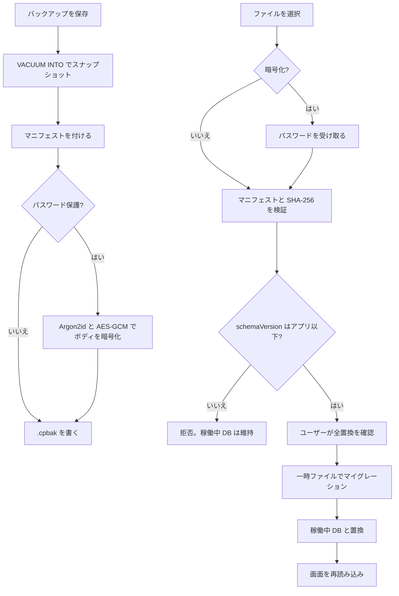

# バックアップ・リストア — 設計書

- **Linear Issue**: [TOP-40](https://linear.app/topea-3/issue/TOP-40/バックアップリストア機能の設計) バックアップ・リストア機能の設計
- **ステータス**: Reviewed
- **最終更新**: 2026-10-17

---

## 1. 背景・目的

住所録・差出人・送受信履歴・印刷レイアウトは、端末ローカルの SQLite（`craft_post.db`）にだけある。アンインストールやユーザーデータの削除で消える。クラウドには置かない。

ユーザーが任意のタイミングで、その DB 全体を 1 ファイルとして保存し、あとから現在の DB と置き換えて戻せるようにする。

---

## 2. スコープ

### 対象

| 領域 | 内容 |
|------|------|
| バックアップ | 起動中の DB から一貫したスナップショットを作り、マニフェストと一緒に `.cpbak` へ書く |
| リストア | `.cpbak` を検証し、現在の `craft_post.db` を全置換する。古いスキーマは置換前に前方マイグレーションする |
| パスワード | 作るときに任意。保護したファイルは復元時にパスワードが要る |
| 画面 | サイドメニュー「バックアップ」（`/settings/backup`） |
| DB 接続 | リストアでファイルを差し替えるため、プールを差し替えられる `AppDb` を導入する |

### 非スコープ

- オンライン / クラウドバックアップ
- ローカル自動バックアップ（頻度・保存先・保持数）。要件には残し、別 Issue で設計する
- 論理 JSON / CSV の入出力（住所録ドメインで別検討のまま）
- 一部テーブルだけ、または既存行へのマージ
- バックアップファイルの中身を人が編集する機能
- 前回の保存先をアプリが覚えること
- API デバッグログ、生成した PDF、アプリ本体、フォント

### ユーザー確認（2026-10-17）

| 論点 | 決定 |
|------|------|
| 作業ブランチ | `develop` から `feature/TOP-40_backup-restore-design` |
| 方式 | SQLite の一貫コピー + マニフェスト JSON（`.cpbak`） |
| 自動バックアップ | 今回の設計に含めない |
| リストア | 現在の DB を全置換する |
| 保護 | 暗号化しないことも、パスワードで保護することもできる |

---

## 3. 要件

### 機能要件

| ID | 要件 |
|----|------|
| FR-01 | バックアップは `craft_post.db` の全内容（全テーブルと `_sqlx_migrations`）を含む。テーブル一覧をアプリ側で列挙しない |
| FR-02 | スナップショットは `VACUUM INTO` で作る。開いている接続からのファイルコピーはしない |
| FR-03 | 成果物は 1 ファイル。拡張子は `.cpbak`。既定のファイル名は `craft-post-backup-YYYYMMDD-HHMMSS.cpbak`（端末ローカル時刻） |
| FR-04 | パスワード保護はチェック式。オフのときは平文コンテナ。オンのときはパスワード必須 |
| FR-05 | パスワードは Unicode スカラー 8 以上 128 以下。作成時は確認入力と一致すること。空文字では保護しない。KDF 前に NFC 正規化する |
| FR-06 | 保護時の暗号は Argon2id + AES-256-GCM。パラメータはファイルヘッダに書く |
| FR-07 | 保存先はユーザーが保存ダイアログで選ぶ。拡張子が `.cpbak` でないパス、稼働中 DB、復元用の一時ファイルは拒否する |
| FR-08 | リストアはファイル選択後に内容（作成日時、作成元アプリのバージョン、パスワード保護の有無）を見せ、確認チェックのあとでだけ実行する |
| FR-09 | リストアは現在の DB をバックアップの内容で置き換える。マージしない |
| FR-10 | バックアップの `schemaVersion` が、実行中アプリに含まれる最新マイグレーションより新しいときは置き換えない |
| FR-11 | `schemaVersion` がアプリと同じか古いときは、稼働中 DB を触る前に一時ファイルへ前方マイグレーションし、成功したときだけ置き換える。同じ version では追加の適用は無い |
| FR-12 | 置き換えに失敗したとき、または起動時に中断跡があるときは、置換前の DB に戻す |
| FR-13 | 復元成功後は画面の状態を捨て、アプリを再読み込みする |
| FR-14 | パスワードとファイル本文はログに出さない |

### 非機能要件

- オフライン完結。ネットワークは使わない
- バックアップとリストアは同時に 1 つ。他の DB コマンドが read lock を持っているときは、write lock を最大 30 秒待ち、取れなければ `busy`
- コンテナの上限は 512 MiB。マニフェスト JSON の上限は 64 KiB
- 個人情報は端末の外へ送らない。保護しないファイルは、保存先の OS 権限だけに依存する
- 開発用 identifier（`com.topea.craftpost.dev`）と本番（`com.topea.craftpost`）の DB は別ファイルである。`.cpbak` はスキーマが互換ならどちらへも復元できる

---

## 4. 現状分析

### 関連 docs

| ドキュメント | 関係 |
|-------------|------|
| [requirements-and-constraints.md](../overview/requirements-and-constraints.md) | 手動バックアップ、ローカル自動、リストア、クラウドなし。本設計で手動方式を確定し、自動は別 Issue と明記する |
| [data-persistence-decision.md](../tech-decisions/data-persistence-decision.md) | SQLite 1 ファイル。JSON/CSV も候補だった。TOP-40 で手動は `.cpbak` に決定 |
| [architecture-overview.md](../overview/architecture-overview.md) | 設定・バックアップ画面はラフのみ。自動は将来のまま |
| [decisions-summary.md](../overview/decisions-summary.md) | バックアップ行が JSON/CSV 前提。本設計への参照に更新する |
| 各 v1 設計の非スコープ | CSV 入出力とバックアップは後続のまま。CSV は本設計でも対象外 |
| [address-domain-v1.md](../domain/address-domain-v1.md) | CSV 仕様は別タイミング。DB スキーマは変えない |

### 関連実装

| 領域 | 現状 | ギャップ |
|------|------|----------|
| DB | `BaseDirectory::AppData` の `craft_post.db`。`sqlx` プールを `app.manage(pool)` で固定。ジャーナルは既定の DELETE。WAL は有効にしていない | プールを後から差し替えられない。`VACUUM INTO` と復元のリネーム手順が無い |
| 永続データ | `address_entries` / `address_co_recipients`、`sender_entries` / `sender_co_recipients` / `sender_address_links`、`postcard_receipts`、`postcard_sends` / `print_layout_preferences`、`_sqlx_migrations` | すべて DB ファイルに含まれる。ファイル単位で足りる |
| ログ | API デバッグログはセッション内だけ。DB に無い | バックアップ対象外 |
| コマンド | `State<'_, SqlitePool>` を各コマンドが直接受ける | `AppDb` の read guard を、クエリが終わるまで保持する形に変える |
| ファイルダイアログ | `tauri-plugin-dialog` は未導入。PDF は WebView のダウンロード | 保存・選択ダイアログと capability を追加する |
| 画面 | サイドメニューにバックアップが無い | `/settings/backup` を追加する |
| 最新スキーマ | `0009_add_nenga_send_target.sql` | 互換判定はファイル名の固定値ではなく、バイナリに含まれるマイグレータの最大 version |

### ギャップ

`AppDb` → コンテナの読み書き → `create_backup` / `inspect_backup` / `restore_backup` → ダイアログと画面。DB のテーブル定義は変えない。

---

## 5. 設計

### 5.1 データモデル / DB

アプリのテーブルは増減しない。バックアップは DB ファイルそのものである。

#### 5.1.1 コンテナ（`.cpbak`）

ヘッダは固定 48 バイト、リトルエンディアン。

| オフセット | サイズ | 内容 |
|-----------|--------|------|
| 0 | 4 | magic `CPBK`（`43 50 42 4B`） |
| 4 | 2 | `format_version`。現在は `1` |
| 6 | 2 | flags。bit 0 = 暗号化。version 1 では他の bit は 0 |
| 8 | 16 | Argon2 salt。非暗号化時は 0 |
| 24 | 4 | Argon2 memory KiB。非暗号化時は 0 |
| 28 | 4 | Argon2 iterations。非暗号化時は 0 |
| 32 | 4 | Argon2 parallelism。非暗号化時は 0 |
| 36 | 12 | AES-GCM nonce。非暗号化時は 0 |

ボディはオフセット 48 から末尾まで。

- 非暗号化: 平文ボディ
- 暗号化: 平文ボディを AES-256-GCM で暗号化したバイト列（タグ 16 バイトを含む）

平文ボディ:

| フィールド | 内容 |
|-----------|------|
| `manifest_len` | u32。マニフェスト JSON のバイト長 |
| manifest | UTF-8 JSON。BOM なし |
| db | 残りのバイト。`VACUUM INTO` した SQLite ファイル |

暗号化時の AAD はヘッダ 48 バイト。ヘッダを改ざんすると復号に失敗する。

書き込み時の KDF / 暗号（ヘッダにも同じ値を記録する）:

| 項目 | 値 |
|------|-----|
| KDF | Argon2id |
| salt | OS の乱数 16 バイト（ファイルごと） |
| memory | 19456 KiB（19 MiB） |
| iterations | 2 |
| parallelism | 1 |
| key | 32 バイト |
| 暗号 | AES-256-GCM |
| nonce | OS の乱数 12 バイト（ファイルごと） |

#### 5.1.2 マニフェスト

必須キーは次のとおり。不明キーは無視する。

```json
{
  "formatVersion": 1,
  "appVersion": "0.1.1",
  "schemaVersion": 9,
  "createdAt": "2026-10-17T09:00:00+09:00",
  "dbFileName": "craft_post.db",
  "dbSha256": "0123456789abcdef0123456789abcdef0123456789abcdef0123456789abcdef"
}
```

| キー | 規則 |
|------|------|
| `formatVersion` | `1`。ヘッダの `format_version` と一致する |
| `appVersion` | `CARGO_PKG_VERSION`。空でなく 32 文字以内。互換判定には使わない |
| `schemaVersion` | `_sqlx_migrations` の `success = 1` の最大 `version`。1 以上 |
| `createdAt` | 端末ローカルオフセット付き RFC3339 |
| `dbFileName` | `craft_post.db` 固定 |
| `dbSha256` | DB バイト列の SHA-256。小文字 hex 64 文字 |

`schemaVersion` の例 `9` は、設計時点の最新マイグレーション `0009` である。実装はマイグレータから最大 version を取る。

#### 5.1.3 互換

判定は次の順で、最初に一致したエラーを返す。

1. コンテナが 512 MiB を超える → `unsupported_format`
2. magic が `CPBK` でない、または 48 バイトに満たない → `not_backup`
3. `format_version` が 1 でない、または未知の flag bit がある → `unsupported_format`
4. 暗号化フラグがありパスワードが無い → `password_required`（復号しない）
5. 暗号化フラグがあり GCM が失敗 → `password_invalid`（パスワード違いと破損を区別しない）
6. 暗号化フラグが無くパスワードが渡されている → `unsupported_format`
7. マニフェスト長が 64 KiB を超える、JSON として読めない、必須キー不足、`formatVersion` 不一致、`dbFileName` 不一致、成功したマイグレーションが無い → `unsupported_format`
8. SHA-256 不一致、または DB 先頭が `SQLite format 3\0` でない → `checksum_mismatch`（復号に成功したあとも同じ）
9. `schemaVersion` がアプリの最新より大きい → `schema_too_new`。稼働中 DB は変更しない
10. `schemaVersion` がアプリ以下 → 受理。`inspect_backup` はここで終わり、ファイルも稼働中 DB も変更しない。`restore_backup` だけが、このあと一時ファイルへ書いてマイグレーションしてから置換する

#### 5.1.4 パス

拒否するパス（canonicalize 後）:

- 稼働中の `craft_post.db`
- 同じディレクトリの `craft_post.db.incoming` / `craft_post.db.pre-restore` / `craft_post.backup-snapshot.db`
- ディレクトリ
- 拡張子が `.cpbak` でないもの（大文字小文字は区別しない）

それ以外の、ユーザーがダイアログで選んだ絶対パスは許可する。USB や別フォルダへ出せる。

### 5.2 API / Tauri コマンド

Rust がファイルを読み書きする。DB バイトは WebView に渡さない。パスワードはコマンド引数でのみ受け取り、ログとエラーメッセージに含めない。使用後は `zeroize` する。

ダイアログはフロントの `@tauri-apps/plugin-dialog`。Rust 側は渡されたパスを 5.1.4 で検証する。`lib.rs` で `tauri_plugin_dialog::init()` を登録し、`capabilities/default.json` に `dialog:default` を足す。

#### 5.2.1 `AppDb`

```rust
pub struct AppDb {
    inner: tokio::sync::RwLock<SqlitePool>,
}
```

- 起動時に今の `init_pool` の結果を入れる。`app.manage` する型は `SqlitePool` から `AppDb` に変える
- 各コマンドは `State<'_, AppDb>` を受け、read guard をクエリ完了まで保持する。既存の `*_impl(pool: &SqlitePool)` はそのまま呼ぶ
- バックアップとリストアは write lock を取る。30 秒以内に取れなければ `busy`
- Tauri の `manage` は差し替えできないため、プールの入れ替えは `AppDb` の内側だけで行う

#### 5.2.2 コマンド

エラーは `Err` の文字列に JSON を入れる。フロントは `JSON.parse` し、失敗時は文字列をそのまま表示する。

```json
{ "code": "password_required", "message": "このバックアップはパスワードで保護されています。" }
```

| code | message |
|------|---------|
| `password_required` | このバックアップはパスワードで保護されています。 |
| `password_invalid` | パスワードが違うか、ファイルが壊れています。 |
| `password_policy` | パスワードは 8 文字以上 128 文字以内で入力してください。 |
| `not_backup` | Craft Post のバックアップファイルではありません。 |
| `unsupported_format` | このバックアップ形式には対応していません。 |
| `schema_too_new` | このバックアップは新しいバージョンのアプリで作成されています。アプリを更新してから復元してください。 |
| `checksum_mismatch` | バックアップファイルが壊れています。 |
| `busy` | 他の処理がデータベースを使用中です。しばらくしてから再度実行してください。 |
| `invalid_path` | この場所には保存できません。 |
| `io` | ファイルを読み書きできませんでした。 |

`create_backup(destinationPath, password | null) -> BackupInspection`

`inspect_backup(sourcePath, password | null) -> BackupInspection`

`restore_backup(sourcePath, password | null) -> BackupInspection`

```ts
type BackupInspection = {
  createdAt: string
  appVersion: string
  schemaVersion: number
  encrypted: boolean
  byteSize: number
}
```

`byteSize` はコンテナのバイト長。`inspect_backup` は稼働中 DB を変更しない。`restore_backup` は inspect 結果を信用せず、同じ検証をやり直す。

#### 5.2.3 バックアップ手順

1. write lock
2. パスワードを検証（null なら平文。Some なら FR-05）
3. 保存先を検証。親ディレクトリが無ければ `io`（ダイアログが選んだ既存フォルダだけを使う）
4. `{app_data}/craft_post.backup-snapshot.db` が残っていれば削除し、`VACUUM INTO` で作る。トランザクションの中では実行しない。パスはアプリが決めたものだけを使い、SQL 文字列では単一引用符を二重にする。その接続の `busy_timeout` は 5 秒。`SQLITE_BUSY` は `busy` として返し、稼働中 DB は変更しない
5. スナップショットの SHA-256 と `schemaVersion` を読み、マニフェストを作る
6. コンテナを `{destination}.partial` に書く。暗号化する場合はここで行う
7. 既存の保存先があれば置き換えてリネームする
8. スナップショットファイルを削除する
9. lock を放す

手順 4 以降の失敗では稼働中 DB を変更しない。`.partial` とスナップショットは削除する。

#### 5.2.4 リストア手順

1. write lock
2. コンテナを読み、5.1.3 で検証する。不合格なら稼働中 DB はそのまま
3. 平文 DB を `{app_data}/craft_post.db.incoming` に書く
4. incoming だけを別プールで開き、マイグレーションする。失敗したら incoming を削除し、稼働中プールは開いたまま返す
5. incoming プールを閉じる
6. 稼働中プールを `close` する
7. `craft_post.db-journal` / `craft_post.db-wal` / `craft_post.db-shm` があれば削除する
8. `craft_post.db` を `craft_post.db.pre-restore` にリネームする
9. incoming を `craft_post.db` にリネームする
10. 新しいプールを開いてマイグレーションする（ここでは追加適用が無い想定）
11. 成功したら `pre-restore` を削除し、`AppDb` の中身を新しいプールにする
12. 失敗したら `pre-restore` を `craft_post.db` に戻して開き直し、エラーを返す

#### 5.2.5 起動時の中断回復

`init_pool` の前に、AppData 上で次を行う。

| 状態 | 動作 |
|------|------|
| `craft_post.db` も `pre-restore` も無い | 従来どおり `create_if_missing` で新規作成する |
| `craft_post.db` が無く、`pre-restore` がある | `pre-restore` を `craft_post.db` に戻す |
| 両方ある | `craft_post.db` を開いてマイグレーションする。成功したら `pre-restore` を削除する。失敗したら `pre-restore` に戻して開き直す |
| 上の判定のあと、`craft_post.db.incoming` または `craft_post.backup-snapshot.db` がある | 削除する |

戻した DB も開けないときは起動を失敗させる。空の DB を新規作成して取り繕わない。

### 5.3 フロントエンド

ルート `/settings/backup`。サイドメニューの末尾に「バックアップ」を足す。`/addresses/:id` より具体的な静的パスなので、並びは末尾でよい。

画面は 1 ページ、2 区画。

**バックアップを作成**

- 説明: 住所録、差出人、送受信履歴、印刷レイアウトを 1 つのファイルに保存する
- チェック「パスワードで保護する」。オフが初期値
- オンのときだけ「パスワード」「パスワード（確認）」を出す
- 「バックアップを保存」で保存ダイアログを開く。既定名は 5.1 のタイムスタンプ
- ダイアログをキャンセルしたら何もしない
- 成功メッセージ: 「バックアップを保存しました」と保存したパス

**バックアップから復元**

- 「バックアップファイルを選択」。フィルタは `Craft Post バックアップ (*.cpbak)`
- 選択直後の `inspect_backup` はパスワード `null` で呼ぶ。フロントはヘッダを自分で読まない
- 結果が `password_required` のときだけ、パスワード欄と「内容を確認」を出す。再呼び出しではそのパスワードを渡す
- inspect 成功で、作成日時（`ja-JP` のローカル表示）、アプリのバージョン、保護の有無を表示する
- 警告: 「現在の住所録・差出人・送受信履歴・印刷レイアウトは、このバックアップの内容で完全に置き換わります。置き換え後は元に戻せません。必要なら先に現在のデータをバックアップしてください。」
- チェック「現在のデータをこのバックアップで置き換える」がオンのときだけ「復元する」を押せる
- `schema_too_new` のときは理由を出し、「復元する」は出さない
- 成功後に `window.location.reload()` する

どちらかを実行中は、両方のボタンを無効にし、ページ内に「処理しています」を出す。

確認用パスワードの不一致はフロントだけで止め、メッセージは「確認用パスワードが一致しません。」とする。Rust は受け取った 1 本の長さだけを検証する。

### 5.4 フロー



---

## 6. エッジケース・エラー処理

| 状況 | 動作 |
|------|------|
| 新規インストール直後（マイグレーション済みの空 DB） | バックアップも復元もできる |
| 保存先に同名ファイルがある | ダイアログの上書き確認に従う。Rust は `.partial` を書いてからリネームする |
| 別ボリュームへの保存 | `.partial` は保存先と同じディレクトリに作り、同一ボリュームでリネームする |
| 復元中にプロセスが落ちる | 5.2.5 で `pre-restore` か新しい DB のどちらか一方に戻す |
| 保存中にプロセスが落ち、保存先に `.partial` が残る | 起動時には消さない。作成処理が失敗して戻るときだけ削除する |
| パスワード保護されたファイルに、保護なしとして復元しようとした | `password_required`。DB は変えない |
| 保護されていないファイルなのにパスワードを渡した | `unsupported_format`。黙って無視しない。画面の初回 inspect は常に `null` なので、この経路は再呼び出しの誤りである |
| 開発用 DB のバックアップを本番へ復元 | スキーマが互換なら許可する |
| 復元のあと、開いていた編集画面の未保存入力 | reload で捨てる。復元前の警告で足りる |
| ディスク不足 | `io`。スナップショットと `.partial` と incoming は削除し、稼働中 DB は維持する |
| コンテナが SQLite ではない | `checksum_mismatch` または magic 不一致 |
| バックアップ取得中に他画面が保存した | write lock で DB コマンドを待たせる。スナップショットはその時点の全内容 |

---

## 7. テスト方針

Rust の一時ディレクトリで行う。UI の見た目より、ファイルと DB の結果を優先する。

| ケース | 期待 |
|--------|------|
| 平文の作成 → inspect → 別ファイルの DB へ復元 | 行が一致する。`schemaVersion` と SHA-256 が一致する |
| パスワード付きの往復 | 正しいパスワードで復元できる |
| 誤ったパスワード | `password_invalid`。復元先 DB の中身は変わらない |
| パスワード無しで暗号化ファイルを inspect | `password_required`。復号しない |
| 8 文字未満 | `password_policy`。ファイルを作らない |
| magic 違い、未知 flag、512 MiB 超 | それぞれ `not_backup` / `unsupported_format`。DB は変わらない |
| `schemaVersion` がアプリより新しい | `schema_too_new`。DB は変わらない |
| 1 つ古いマイグレーションの DB を含む `.cpbak` | 復元後のファイルは最新マイグレーションまで適用されている |
| 稼働中 DB 自身のパス、拡張子違い | `invalid_path` |
| incoming のマイグレーション失敗 | 稼働中 DB は元のまま。incoming は残らない |
| 置換後のオープン失敗 | `pre-restore` の内容に戻る |
| 起動時に `craft_post.db` が無く `pre-restore` だけがある | 起動後の DB は `pre-restore` の内容 |
| `VACUUM INTO` の直前に insert した行 | バックアップに含まれる |

フロントは、パスワード確認の不一致でコマンドを呼ばないこと、復元成功で reload すること、をコンポーネントテストで見る。

---

## 8. 実装タスク（参考）

1. `AppDb` を追加し、既存コマンドの `State<'_, SqlitePool>` を read guard に置き換える
2. コンテナの読み書き（ヘッダ、マニフェスト、SHA-256、Argon2id、AES-256-GCM）と単体テスト
3. `create_backup` / `inspect_backup` / `restore_backup` と起動時回復
4. `tauri-plugin-dialog` と capability
5. `/settings/backup` 画面とサイドメニュー
6. 実装が入ったリリースで、README の「バックアップは未提供」を実際の操作に合わせて更新する

---

## 9. 未決事項

なし。自動バックアップの頻度・保存先・保持数は本 Issue の対象外であり、別 Issue で決める。
