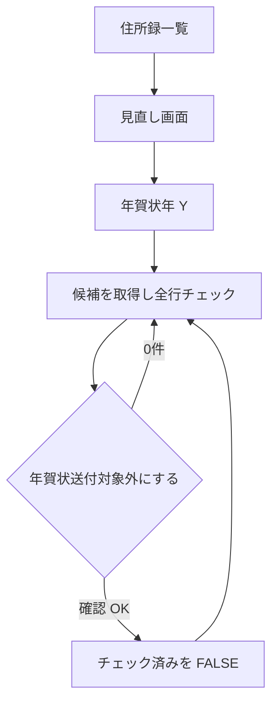
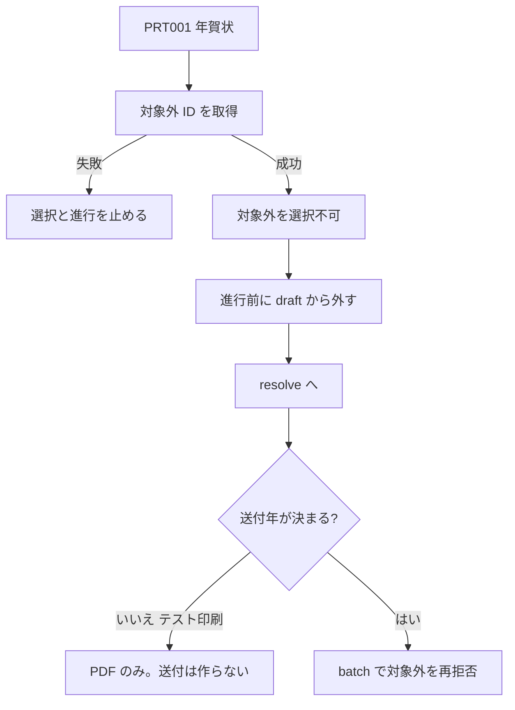

# 年賀状送付対象フラグ — 設計書

- **Linear Issue**: [TOP-35](https://linear.app/topea-3/issue/TOP-35/住所録情報に年賀状送付対象フラグを追加年賀状を受け取らなかった時宛名をリスト化して年賀状送付対象フラグを一括更新できるようにする) 住所録情報に年賀状送付対象フラグを追加・年賀状を受け取らなかった時宛名をリスト化して年賀状送付対象フラグを一括更新できるようにする
- **親 Issue**: [TOP-14](https://linear.app/topea-3/issue/TOP-14/v1-機能設計) v1 機能設計
- **ステータス**: Reviewed
- **最終更新**: 2026-10-17

---

## 1. 背景・目的

年賀状を出し続ける相手を、住所録の属性として残せるようにする。今年の年賀状が届かず、前年の喪中もない相手は、見直し一覧からまとめて送付対象外にできる。対象外にした宛名は、年賀状の印刷対象選択で選べない。

喪中による年単位の印刷除外（[mochu-print-exclusion-v1-design.md](./mochu-print-exclusion-v1-design.md)）とは別である。喪中除外はその年の受取で印刷を止める。本フラグは住所録に残り、ユーザーが編集で戻すまで年賀状印刷の対象にならない。

---

## 2. スコープ

### 対象

| 領域 | 内容 |
|------|------|
| 住所録 DB / ドメイン | `address_entries.nenga_send_target` を追加。既存行と新規のデフォルトは TRUE（対象） |
| 住所録 UI | 新規作成・編集でフラグを変更できる。詳細では読み取り表示する |
| 見直し一覧 | 年賀状年 Y を選び、対象フラグが TRUE の有効な宛名のうち、前年喪中なし・今年年賀状なしを一覧する。初期は全行チェック ON |
| 一括更新 | 「年賀状送付対象外にする」で、チェック済み宛名のフラグを FALSE にする |
| 年賀状印刷 | 印刷対象選択（PRT001）で、フラグ FALSE の宛名を選択不可にする。テスト印刷期間の年賀状も含む |

### 非スコープ

- 喪中はがきの印刷対象選択（フラグでは除外しない）
- 送付状況画面、手動の送付作成・一括送付
- 住所録一覧テーブルへのフラグ列、フラグでの検索
- 見直し一覧からフラグを TRUE に戻す操作（戻すのは住所録の編集のみ）
- CSV 入出力、バックアップ形式の変更
- 住所録更新への楽観ロック追加

### ユーザー確認（2026-10-17）

| 論点 | 決定 |
|------|------|
| 作業ブランチ | `develop` から `feature/TOP-35_nenga-send-target-flag` |
| 年の意味 | 画面で年賀状年 Y を選ぶ。初期値は端末ローカルの今日の西暦年。年賀状は `receipt_year = Y`、喪中は `receipt_year = Y - 1` |
| 一覧とチェック | 前年喪中なし、かつ今年年賀状なしの行だけ出す。初期は全行チェック ON |
| 印刷への反映 | 年賀状の印刷対象選択でフラグ FALSE を選択不可にする。喪中印刷と送付状況画面は変えない |

---

## 3. 要件

### 機能要件

| ID | 要件 |
|----|------|
| FR-01 | `address_entries` に `nenga_send_target` を持つ。既存行を含むデフォルトは TRUE |
| FR-02 | 住所録の新規作成・編集でフラグを保存できる。新規画面の初期値は ON |
| FR-03 | 住所録詳細に「年賀状送付対象」を表示する（対象 / 対象外） |
| FR-04 | 見直し画面で年賀状年 Y（1900〜2100）を指定できる。初期値はローカル日付の西暦年。TOP-34 の送付年決定は使わない |
| FR-05 | 見直し一覧の母集団は、有効（`archived_at IS NULL`）かつ `nenga_send_target = TRUE` かつ、`receipt_year = Y - 1` の有効な喪中受取がなく、かつ `receipt_year = Y` の有効な年賀状受取がない宛名 |
| FR-06 | 一覧の初期表示では、取得した全候補に「年賀状対象外にする」チェックを付ける。ページを分けて表示しても、チェックは全候補分を保持する。ユーザーは外せる |
| FR-07 | 「年賀状送付対象外にする」は、チェックが 1 件以上のときだけ押せる。確認後、チェック済み宛名のフラグを FALSE にし `updated_at` を更新する |
| FR-08 | 種別が年賀状の PRT001 では、フラグ FALSE の有効な宛名を状態「対象外」とし選択不可にする。送付年が決まらないテスト印刷期間でも除外する |
| FR-09 | 種別が喪中の印刷では、本フラグで選択可否を変えない |
| FR-10 | 年賀状かつ送付年が決定できるときの `create_postcard_sends_batch` は、フラグ FALSE の宛名を Validation で拒否する |

### 非機能要件

- オフライン完結（SQLite / Tauri）
- 受取の有無は `postcard_receipts.receipt_year` と `category` で判定する。`received_at` から年を再計算しない
- 見直しの「今日」はフロントのローカル西暦年だけを初期値に使う。UTC 日付（`toISOString` の年）は使わない
- 一括更新は 1 トランザクション。途中失敗で一部だけ FALSE にしない
- 既存の住所録 INSERT が列を省略しても成立するよう、DB デフォルトは 1

---

## 4. 現状分析

### 関連 docs

| ドキュメント | 関係 |
|-------------|------|
| [address-domain-v1.md](../domain/address-domain-v1.md) | `AddressEntry` にフラグが無い。本設計で属性と列を追加する |
| [postcard-receipt-v1-design.md](./postcard-receipt-v1-design.md) | 受取は住所録 1 : N。年賀状 / 喪中 / その他。匿名は `address_entry_id` NULL |
| [mochu-print-exclusion-v1-design.md](./mochu-print-exclusion-v1-design.md) | 年賀状かつ送付年決定時、`receipt_year = 送付年 - 1` の喪中を選択不可。本フラグとは別条件 |
| [postcard-address-print-v1-design.md](./postcard-address-print-v1-design.md) | PRT001 の選択と `create_postcard_sends_batch`。本設計は年賀状の選択不可理由を 1 つ増やす |
| mock-up `address-entry/*`、`postcard-print/postcard-print-select-view-mockup.md` | 画面差分の起点 |

### 関連実装

| 領域 | 現状 | ギャップ |
|------|------|----------|
| `address_entries` | 送付対象列なし。作成・更新は明示列の INSERT / UPDATE | 列、ドメイン、DTO、リポジトリの読み書き |
| 住所録フォーム | 氏名・住所・メモのみ。`AddressEntryDtoInput` にフラグなし | チェックボックスと入出力 |
| 受取 | `receipt_year` + `category`。喪中宛名 ID 一覧コマンドあり | 見直し用の anti-join が無い |
| PRT001 | 年賀状かつ送付年決定時だけ喪中 ID を取得し、失敗時は fail-closed。テスト印刷では喪中除外しない | 年賀状では常に対象外 ID を除外する |
| `create_postcard_sends_batch` | テスト印刷は送付を作らず return。送付年決定時の年賀状は喪中宛名を拒否 | 同じ経路でフラグ FALSE を拒否する |
| `resolve_print_job_items` | 種別を知らない。差出人未紐づけは除外アラート、archived は失敗 | ここではフラグ判定を足さない。PRT001 が進む前に draft から外す |
| ルーティング | `/addresses/new` の次が `/addresses/:id` | 見直しルートは `:id` より前に置く |

### ギャップ

下位から埋める。migration → `AddressEntry` とリポジトリ → 作成・更新 DTO → 見直しコマンド → 住所録 UI → PRT001 と印刷 batch。

---

## 5. 設計

### 5.1 データモデル / DB

#### 5.1.1 migration（`0009_add_nenga_send_target.sql`）

```sql
ALTER TABLE address_entries
  ADD COLUMN nenga_send_target INTEGER NOT NULL DEFAULT 1
  CHECK (nenga_send_target IN (0, 1));

CREATE INDEX IF NOT EXISTS idx_address_entries_active_nenga_send_target
  ON address_entries (nenga_send_target)
  WHERE archived_at IS NULL;
```

- `1` = 対象、`0` = 対象外
- 既存行は DEFAULT により対象のまま
- 列を書かない既存テスト INSERT はそのまま動く
- アプリは 0/1 だけを書く。CHECK は手修正の歯止め

#### 5.1.2 エンティティ

`AddressEntry` に `nenga_send_target: bool` を追加する。

- `create_new` / `from_persisted` の引数に含める
- 新規のドメイン初期値は `true`
- `archive` はフラグを変えない（`updated_at` も現行どおり変えない）
- 通常の `update` はフォームから渡った bool を保存する。省略時に TRUE へ戻すデフォルトは置かない（DTO の必須フィールド）

#### 5.1.3 見直しの抽出

年賀状年 `Y` に対する候補:

```sql
SELECT ae.id
FROM address_entries ae
WHERE ae.archived_at IS NULL
  AND ae.nenga_send_target = 1
  AND NOT EXISTS (
    SELECT 1 FROM postcard_receipts r
    WHERE r.address_entry_id = ae.id
      AND r.deleted_at IS NULL
      AND r.category = 'mochu'
      AND r.receipt_year = ?  -- Y - 1
  )
  AND NOT EXISTS (
    SELECT 1 FROM postcard_receipts r
    WHERE r.address_entry_id = ae.id
      AND r.deleted_at IS NULL
      AND r.category = 'nenga'
      AND r.receipt_year = ?  -- Y
  )
ORDER BY ae.primary_kana_last, ae.primary_kana_first, ae.primary_last, ae.primary_first
```

- 受取が 1 件でもあれば「受け取った」
- `category = other` は年賀状受取に数えない
- `address_entry_id IS NULL` の匿名受取はどの宛名にも結び付かない
- `deleted_at` 済み受取は見ない
- ソートは住所録一覧の氏名カナ昇順に合わせる

年の例（初期値は今日のローカル西暦。11〜12 月でも送付年の翌年にはしない）:

| 今日 | 初期 Y | 年賀状の受取年 | 喪中の受取年 |
|------|--------|----------------|--------------|
| 2026-01-15 | 2026 | 2026 | 2025 |
| 2026-10-17 | 2026 | 2026 | 2025 |
| 2026-12-15 | 2026 | 2026 | 2025 |

ユーザーが Y を 2025 に変えれば、年賀状 2025・喪中 2024 で同じ条件を再評価する。

#### 5.1.4 一括で FALSE にする

チェック済み ID ごとに、次を 1 トランザクションで実行する。

```sql
UPDATE address_entries
SET nenga_send_target = 0,
    updated_at = ?
WHERE id = ?
  AND archived_at IS NULL
  AND nenga_send_target = 1
```

- 更新できた行数を `updated_count` とする
- 存在しない、アーカイブ済み、すでに FALSE の ID は `skipped_count` とし、全体は失敗させない
- 連名テーブルは触らない（通常の住所録更新とは別経路）

### 5.2 API / Tauri コマンド

DTO は現行どおり snake_case。`AddressEntryDto` と `AddressEntryDtoInput` に `nenga_send_target: bool` を追加する。作成・取得・一覧・検索の応答に含める。

住所録の読み取り SELECT（`find_by_id`、一覧、検索、`resolve_print_job_items` の住所組み立て）は列を追加する。フラグを使わないクエリは列追加不要。

| コマンド | 契約 |
|----------|------|
| `create_address_entry` / `update_address_entry` | 入力の bool を保存する |
| `get_address_entry` / `list_address_entries` / `search_address_entries` | 応答に bool を含める |
| `list_nenga_target_review` | 引数 `year: i32`。`1900..=2100` 以外は Validation。候補を全件返す（上限 2000）。超過は Validation |
| `disable_nenga_send_targets` | 引数 `ids: Vec<String>`。空は Validation。2000 件超は Validation。重複 ID は除去。戻り値 `{ updated_count, skipped_count }` |
| `list_nenga_send_excluded_address_entry_ids` | 有効かつ `nenga_send_target = 0` の ID 一覧。PRT001 用。ページに依存しない |

`list_nenga_target_review` の 1 件は、一覧表示に足る `id`、氏名、連名、敬称、郵便番号、住所。メモは返さない。

ユーザー向け Validation 文言:

| 条件 | 文言 |
|------|------|
| 年が範囲外 | 「年賀状年は 1900 から 2100 の範囲で指定してください。」 |
| 見直しが 2000 件超 | 「候補が 2000 件を超えています。条件を確認してください。」 |
| 一括更新の ID が空 | 「更新する宛名を選択してください。」 |
| 一括更新が 2000 件超 | 「一度に更新できるのは 2000 件までです。」 |
| 印刷 batch に対象外が含まれる | 「年賀状送付対象外の宛名が含まれています。印刷対象から外してください。」 |

取得失敗のリポジトリエラーは既存と同様にログへ出し、固定の失敗コードを返す（`ADDR_NENGA_TARGET_REVIEW_FAILED` など）。画面はそのコードをそのまま出さず、固定メッセージにする。

#### 5.2.1 印刷 batch

`create_postcard_sends_batch` の既存順を維持する。

1. テスト印刷期間の年賀状は送付を作らず return（現行どおり。この中ではフラグを見ない）
2. 年賀状かつ送付年決定時は、先に喪中宛名を拒否（現行どおり）
3. その直後、同一バッチにフラグ FALSE の宛名があれば Validation で拒否する

テスト印刷の PDF に対象外を混ぜない制御は PRT001 側で行う。`resolve_print_job_items` は種別を持たないため、フラグ判定は足さない。

### 5.3 フロントエンド

#### 5.3.1 住所録フォーム（ADDR002 / ADDR003）

メモの下にチェックボックス「年賀状送付対象」を置く。

- ON = `true`、OFF = `false`
- 新規の初期値は ON
- 編集は取得した値を初期値にする
- 補足: 「外すと、年賀状の印刷対象に選べなくなります。」

#### 5.3.2 住所録詳細（ADDR004）

メモの前に読み取り行を置く。ON は「対象」、OFF は「対象外」。

#### 5.3.3 住所録一覧（ADDR001）

ヘッダーに「年賀状送付対象の見直し」を置き、`/addresses/nenga-target-review` へ遷移する。一覧の列は増やさない。

ルートは `addresses/new` と同じく `addresses/:id` より前に登録する。

#### 5.3.4 見直し画面（ADDR005）

画面タイトル「年賀状送付対象の見直し」。

- 年賀状年: `input type="number"`。初期値は `new Date().getFullYear()`。最小 1900、最大 2100。空欄や整数でない間はコマンドを呼ばない
- 説明: 選択年の年賀状を受け取っておらず、その前年の喪中もない、送付対象の宛名であること
- 列: チェック（見出し「年賀状対象外にする」）、氏名＋敬称、住所
- 見出しチェックは、ページではなく読み込んだ全候補を ON/OFF する
- 表示は 20 件ずつ。チェック状態は全候補分を保持し、ページをまたいで残す
- 年を変えたら一覧を取り直し、新しい候補はすべて ON に戻す
- ボタン「年賀状送付対象外にする」: チェック 0 件なら disabled
- 押下時の確認: 「選択した N 件の年賀状送付対象を外します。よろしいですか？」
- 成功後は同じ画面に留まり再取得する。`updated_count` が 1 以上なら「N 件を年賀状送付対象外にしました。」スキップがあれば「M 件はすでに対象外かアーカイブ済みのため変更しませんでした。」を続ける。`updated_count = 0` のときは「更新できる宛名がありませんでした。」
- 0 件: 「この年賀状年で、送付対象を外す候補はありません。」
- 取得失敗: 「見直し一覧の取得に失敗しました。時間をおいて再度お試しください。」

#### 5.3.5 印刷対象選択（PRT001）

種別が年賀状のとき、`list_nenga_send_excluded_address_entry_ids` を取得する。喪中印刷では呼ばない。取得結果が 0 件は成功であり、除外なしとして扱う。取得が終わるまで、年賀状では選択の追加と進行を止める（喪中リストの loading と同じ）。

| 種別 | 送付年 | 喪中除外（TOP-34） | 本フラグの除外 |
|------|--------|--------------------|----------------|
| 年賀状 | 決定できる | する | する |
| 年賀状 | テスト印刷 | しない | する |
| 喪中 | 暦年 | しない | しない |

状態ラベルの優先順（上が優先）:

1. 確認中（差出人未解決、または年賀状で喪中／対象外リスト取得中）
2. 喪中
3. 対象外
4. 除外（差出人未紐づけ / archived）
5. OK

「対象外」はチェック不可。「このページのOKを選択」の対象に含めない。既に draft にあれば入場時と「確認へ進む」の直前に外す。外した件数は「N 件は年賀状送付対象外のため選択から外しました。」

取得失敗時は喪中と同じく fail-closed とする。年賀状では選択の追加と進行を止め、次を出す。

「年賀状送付対象の取得に失敗しました。年賀状の選択を続行できません。時間をおいて再度お試しください。」

喪中取得失敗と同時なら両方を表示し、進行は止める。

### 5.4 フロー



年賀状印刷:



---

## 6. エッジケース・エラー処理

| ケース | 扱い |
|--------|------|
| 既存住所録 | migration 後はすべて対象。ユーザーが外すまで年賀状印刷できる |
| 同一年に年賀状受取が複数 | 1 件でもあれば見直し候補から外す |
| 喪中と年賀状の両方がある | 見直し候補から外す。フラグは TRUE のまま。印刷の喪中除外は TOP-34 どおり |
| 前年喪中だけがある | 見直し一覧には出さない。フラグは TRUE のまま。該当する送付年の年賀状印刷では喪中として選択不可 |
| 匿名受取、論理削除済み受取 | 判定に使わない |
| アーカイブ済み宛名 | 見直しにも印刷一覧にも出さない。一括更新は skip |
| 一覧取得後に受取を追加してから一括更新 | 受取条件は再判定しない。チェック済みで有効かつ TRUE なら FALSE にする |
| 編集画面を開いたまま一括更新し、その後編集を保存 | 既存の住所録更新と同じ後勝ち。開いた時点のフラグで上書きしうる。楽観ロックは足さない |
| 対象外かつ喪中 | ラベルは「喪中」。どちらでも選択不可 |
| 対象外かつ差出人未紐づけ | ラベルは「対象外」。選択不可 |
| フラグ FALSE をテスト印刷で選ぼうとする | PRT001 で選択不可。batch はテスト印刷のため送付作成前に return する |
| フラグ FALSE が draft に残ったまま送付年ありの batch に入る | Validation で拒否。喪中拒否より後に判定する |
| ID 重複 | 一括更新の前に除去する |
| 年の変更中の古い応答 | 年が変わっていたら結果を捨てる |

---

## 7. テスト方針

| 層 | 観点 |
|----|------|
| migration | 既存行のフラグが 1。列省略 INSERT が 1 になる |
| domain | 作成時 true、更新で false を保持、archive でフラグが変わらない |
| repository | 見直し抽出（年賀状あり / 喪中あり / other のみ / 削除済み受取 / 匿名 / archived / すでに FALSE）。一括更新の updated と skipped。対象外 ID 一覧 |
| command | 年範囲、空 ID、2000 件超、batch が年賀状・送付年決定時に FALSE を拒否する。テスト印刷の batch は現行どおり skipped。喪中印刷の batch はフラグ FALSE でも拒否しない |
| frontend | 新規初期値 ON。見直しの初期全チェック、0 件 disabled、年変更でチェック復帰。PRT001 は年賀状（テスト印刷を含む）で対象外を選べず、喪中印刷ではフラグで止めない。対象外リスト失敗で進行できない |

---

## 8. 実装タスク（参考）

1. `0009_add_nenga_send_target.sql`
2. `AddressEntry` と住所録リポジトリの読み書き、DTO、作成・更新
3. `list_nenga_target_review` / `disable_nenga_send_targets` / `list_nenga_send_excluded_address_entry_ids`
4. 住所録の作成・編集・詳細、一覧からの導線、ADDR005
5. PRT001 の状態「対象外」、draft からの除去、fail-closed
6. `create_postcard_sends_batch` の年賀状・送付年決定時の拒否
7. ドメイン文書・モックは本設計と同時に更新済み。実装時は差分が出た箇所だけ合わせる

---

## 9. 未決事項

なし。

編集画面を開いたまま一括更新したときの後勝ちは、現行の住所録更新に合わせた決定である。楽観ロックは本 Issue では足さない。

---

## 変更履歴

| 日付 | 内容 |
|------|------|
| 2026-10-17 | 初版。TOP-35。年賀状年は選択式、一覧は未受取のみ全チェック、年賀状印刷で対象外を選択不可。 |
